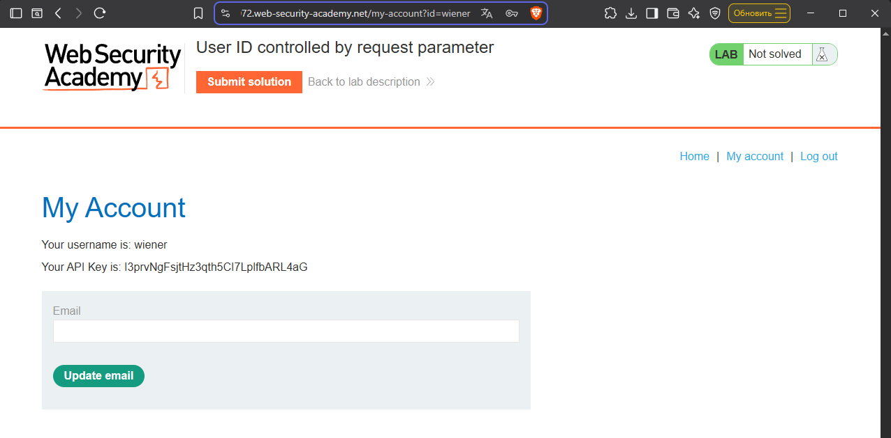
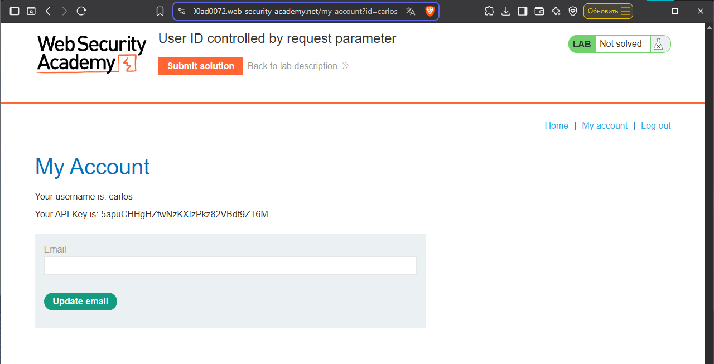
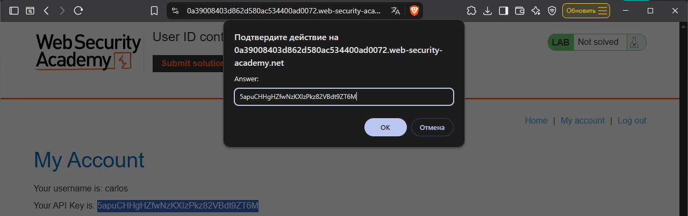

# Lab: User ID controlled by request parameter

Level: `APPRENTICE`

## Description

> This lab has a horizontal privilege escalation vulnerability on the user account page.

To solve the lab, obtain the API key for the user `carlos` and submit it as the solution.

You can log in to your own account using the following credentials: `wiener:peter`

# Solution

Первым делом заходим в аккаунт по предоставленным кредам:
- login: `wiener`
- password: `peter`

И видим следующую картину:

И видим потенциальный `IDOR` в URL, вставляем вместо нашего логина, логин жертвы и вуаля, получаем доступ:

Дальше копируем API-ключ и нажимаем на кнопку `Submit solution`

Вот лаба и решена. 
> *Это классический пример `Horizontal Privilege Escalation`, реализованный через `IDOR`*

# Remediation
Что касается защиты все аналогично как и с [*прошлой лабой на `IDOR`*](..\01-idor\writeup.md)

Но все же деталь есть:
> Сервер должен игнорировать параметр `id` из `URL` при запросе профиля
> и брать `ID` пользователя только из его активной сессии (куки).
> Даже если пользователь поменяет `URL`, сервер должен показать ему только его собственный профиль.
