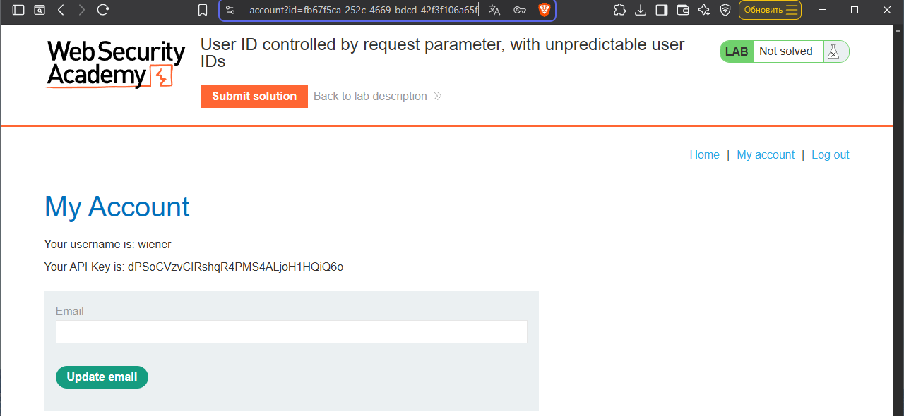
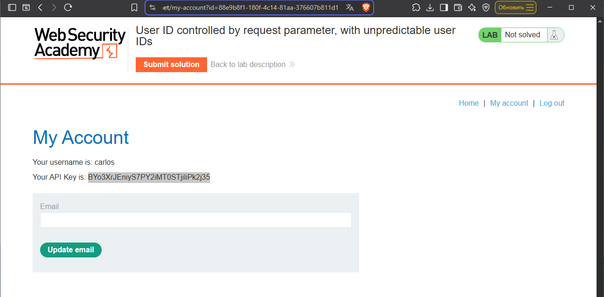

# Lab: User ID controlled by request parameter, with unpredictable user IDs

Level: `APPRENTICE`

## Description

> This lab has a horizontal privilege escalation vulnerability on the user account page, but identifies users with `GUIDs`.

To solve the lab, find the `GUID` for `carlos`, then submit his `API` key as the solution.

You can log in to your own account using the following credentials: `wiener:peter`

# Solution

Первым делом логинимся под известной учеткой:
- login: `wiener`
- password: `peter`

Хм, но в этот раз id сложнее: `id=fb67f5ca-252c-4669-bdcd-42f3f106a65f`

Казалось бы это тупик, ведь генерацию `GUID` мы не знаем, но если погулять по сайту и открыть любой блог,
мы увидим:
- статью
- ссылку на автора
- комментарии

Статья и коментарии нас не интересуеют, а вот ссылка на автора примечательна: `https://0a1a003f0318c61181d38a21001e0030.web-security-academy.net/blogs?userId=88e9b8f1-180f-4c14-81aa-376607b811d1`

Вот мы и нашли `GUID`: `88e9b8f1-180f-4c14-81aa-376607b811d1`

Просто поменяем наш `GUID` на его на страничке аккаунта и увидим его `API-ключ`: `BYo3XrJEniyS7PY2iMT0STjiliPk2j35`

Вот мы и решили лабу

# Remediation

> Использование `GUID` вместо последовательных ID — это хорошая практика (затрудняет перебор),
> но она не заменяет проверку прав доступа. Даже зная `GUID`,
> злоумышленник не должен получить доступ к чужому профилю
