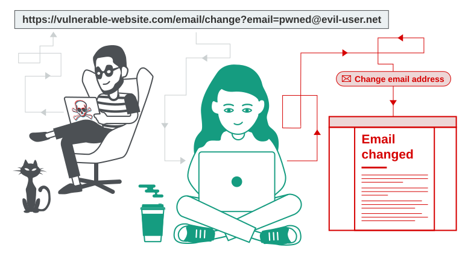

# Cross-Site Request Forgery (CSRF)

## What is CSRF?
Веб-уязвимость, которая позволяет атакующему заставить пользователя выполнить действие, которое он не собирался выполнять. Атака частично обходит `Same-Origin Policy (SOP)`.



## Impact
* Смена email или пароля жертвы (приводит к полному захвату аккаунта).
* Перевод денежных средств.
* Если жертва — админ, то захват всего приложения.

## How does CSRF work? (3 условия)
Атака возможна только при наличии трех условий:
1. `Relevant action`: В приложении есть действие, которое интересно атакующему (смена пароля, перевод денег).
2. `Cookie-based session handling`: Приложение полагается *только* на сессионные куки для идентификации пользователя. Нет других токенов.
3. `No unpredictable parameters`: Запрос не содержит параметров, которые атакующий не может угадать (например, для смены пароля не нужно вводить старый пароль).

Пример уязвимого запроса:
```http
POST /email/change HTTP/1.1
Host: vulnerable-website.com
Cookie: session=yvthwsztyeQkAPzeQ5gHgTvlyxHfsAfE

email=wiener@normal-user.com
```

Пример эксплойта (HTML-форма):
```html
<html>
    <body>
        <form action="https://vulnerable-website.com/email/change" method="POST">
            <input type="hidden" name="email" value="pwned@evil-user.net" />
        </form>
        <script>
            document.forms[0].submit();
        </script>
    </body>
</html>
```

Если жертва залогинена, ее браузер автоматически прикрепит куки к этому запросу, и `email` сменится.

## How to construct a CSRF attack
Вручную писать HTML-формы лень. В `Burp Suite Pro` (и в `Community` тоже) есть генератор:
1. Выбрать запрос в Burp.
2. ПКМ -> Engagement tools -> Generate CSRF PoC.
3. Скопировать HTML и загрузить на свой хост.

## How to deliver a CSRF exploit
* Отправить жертве ссылку на вредоносный сайт (через `email`, соцсети).
* Если запрос можно сделать через `GET`, то эксплойт может быть в одну строку: 
``

## Common defences against CSRF
1. `CSRF` tokens: Уникальный, секретный токен, который генерируется сервером и требуется в каждом запросе. Атакующий не может его угадать.
2. `SameSite cookies`: Механизм браузера. Ограничивает отправку кук в кросс-доменных запросах. С 2021 года `Chrome` по умолчанию ставит `Lax`.
3. `Referer-based validation`: Проверка заголовка `Referer` (откуда пришел запрос). Менее надежно, чем токены.
