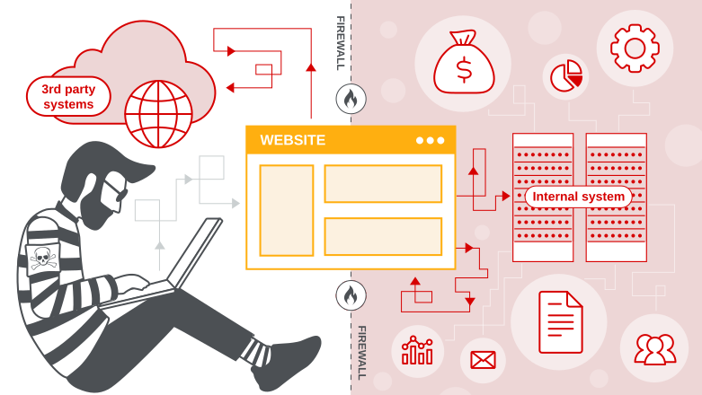

# Server-side request forgery (SSRF)

## What is SSRF?

Это веб-уязвимость, которая позволяет приложению
со стороны сервера выполнять запросы к
непредумышленным локациям.

Скажем подключиться к внутренним сервисам организации или
и вовсе подключиться к внешним системам, что
ведет к утечке данных.

## Пример

> **Пример уязвимого запроса**
> `POST /product/stock`
> `stockApi=http://stock.weliketoshop.net:8080/product/stock/check?productId=6&storeId=1`

> **Атака**
> Мы меняем URL на внутренний адрес:
> `stockApi=http://localhost/admin`
> Сервер идет по этому адресу сам (от своего имени),
> обходит файрвол и возвращает нам страницу админки.

## Blind SSRF

Все аналогично, но ответ от запроса не возвращается в ответе приложения
пользователю.

**Обнаружение**: Через `Burp Collaborator`.
Вставляем уникальный домен в параметр (например, `Referer`).
Если видим обратный запрос (`DNS`/`HTTP`) -- уязвимость есть.

**Зачем нужен**: Можно сканировать внутреннюю сеть или эксплуатировать другие уязвимости на внутренних серверах.

# Главные векторы атаки

`SSRF` нужен для 2-х вещей:
1. Атака на сам сервер (Localhost):
   Мы заставляем сервер обратиться к себе(`127.0.0.1` или `localhost`)
   Это позволяет обойти внешние средства защиты и получить доступ
   к внутренним админкам и `API`.
2. Атака на другие системы (во внутренней сети):
   Если сервер имеет доступ в локальную сеть (например, `192.168.0.0/24`),
   мы можем заставить его сканировать внутр. порты или достучаться до бд
   и т.д., которые защищены от внешнего мира(находятся за `NAT`)

# Bypass фильтров

Допустим слово `localhost` заблокировано, что делать?
- Альтернативные IP: `127.0.0.1` (можно попробовать в разных с.счисл.)
- **DNS Rebinding**: использовать свой домен при условии, что он резолвится
- Обход через **Open Redirect**: Если он есть, можно заставить его
  перекинуть запрос на внутренний ресурс, что обойдет проверку `URL`
