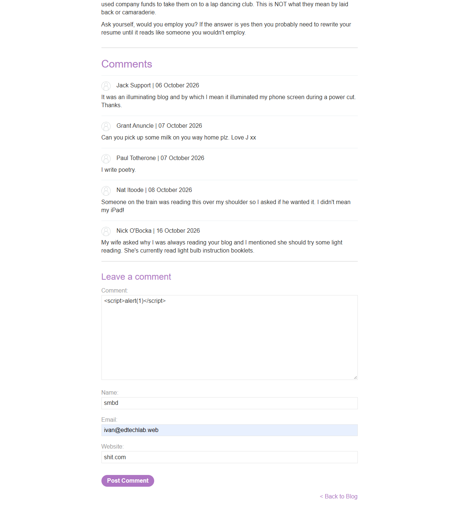
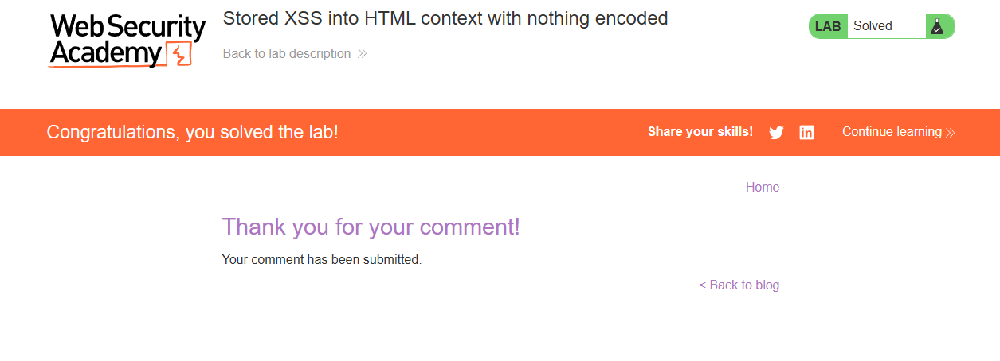

# Lab: Stored XSS into HTML context with nothing encoded

| | |
|---|---|
| **Платформа / Событие** | PortSwigger Web Security Academy |
| **Категория** | xss |
| **Сложность** | — |
| **Статус** | done |
| **Дата решения** | 2026-11-15 |
| **Ссылка на таск** | — |

level: APPRENTICE

## Description

This lab contains a stored cross-site scripting vulnerability in the comment functionality.

To solve this lab, submit a comment that calls the alert function when the blog post is viewed.

# Solution

Payload: ``

