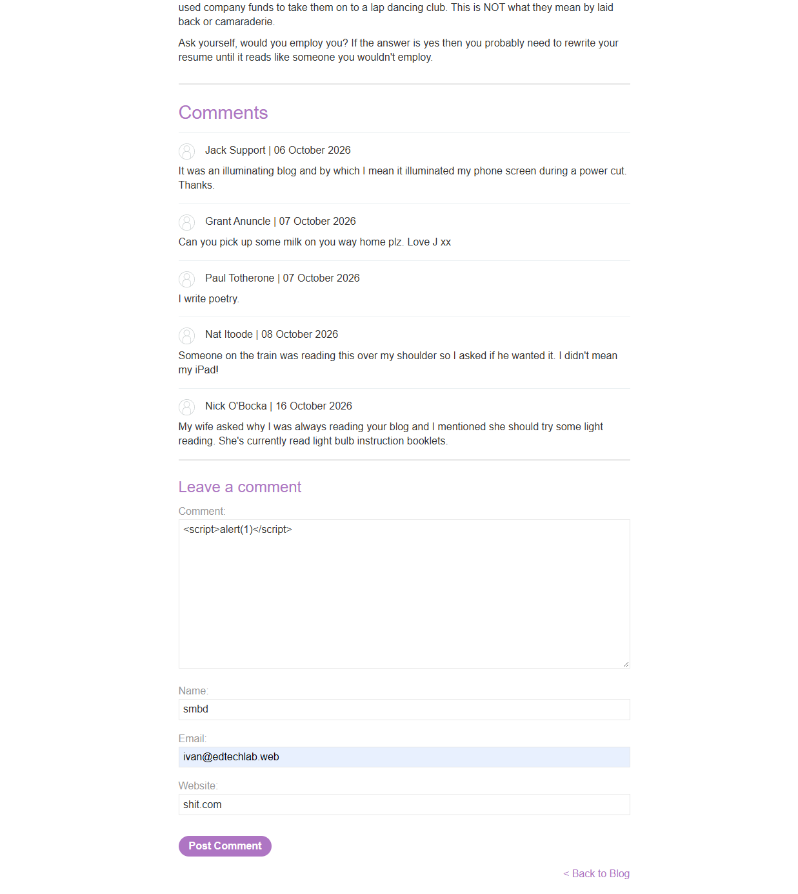
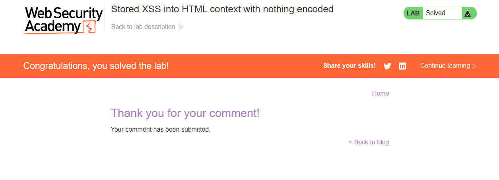

# Lab: Stored XSS into HTML context with nothing encoded

level: APPRENTICE

## Description

This lab contains a stored cross-site scripting vulnerability in the comment functionality.

To solve this lab, submit a comment that calls the alert function when the blog post is viewed.

# Solution

Payload: ``

